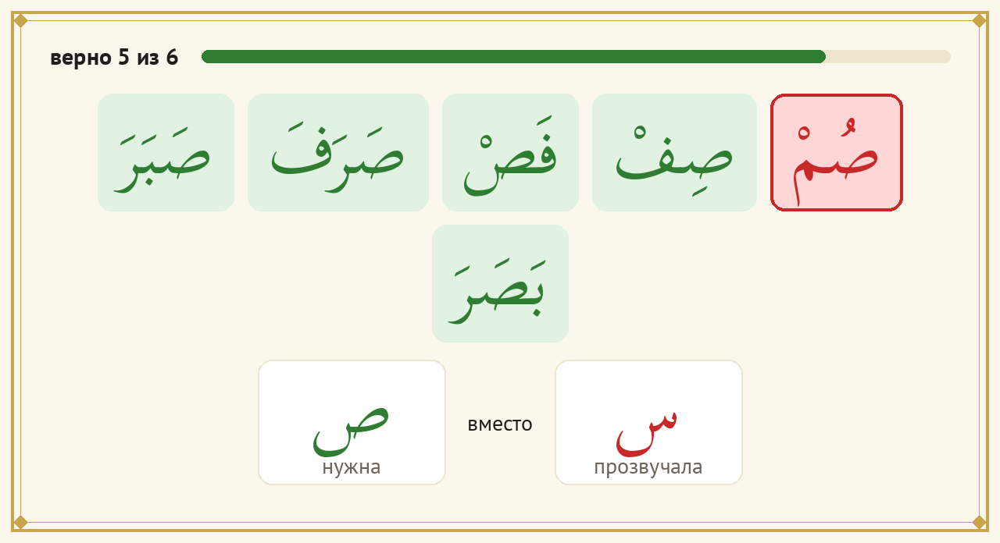
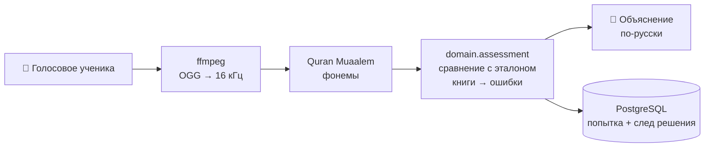

# Muallim — ИИ-тренажёр чтения по «Аль-Муаллим ас-Сани»

[](https://github.com/abdra04-gif/muallim/actions/workflows/ci.yml)


Telegram-бот, который учит **с нуля** читать по-арабски по учебнику Ахмада Хади Максуди
«Муаллим ас-Сани» («Второй учитель»). Ученик читает вслух букву, слог или слово — бот распознаёт
произношение моделью [Quran Muaalem](https://github.com/obadx/quran-muaalem), находит ошибки и
объясняет их по-русски простыми словами. Каждая попытка сохраняется (голос — только с согласия
ученика), чтобы изучать ошибки учеников и модели, размечать данные и улучшать проверку.

Проект — практическая часть магистерской диссертации (Университет Иннополис, программная инженерия, 2027):
**«Автоматическое обнаружение ошибок чтения у начинающих изучать арабский язык и чтение Корана»**.
Автор — Исмаилов А. Е., научный руководитель — Аскарбекулы Н. Бот одновременно учебный инструмент,
способ собрать датасет и полигон, на котором проверяются модели.

> **In English.** *Muallim* is a Telegram bot that teaches Russian-speaking beginners to read Arabic
> from scratch, following the classic primer *al-Muallim ath-Thani* ("The Second Teacher"). The learner
> sends a voice message; the [Quran Muaalem](https://github.com/obadx/quran-muaalem) model recognises
> phonemes, the bot detects reading errors and explains them in Russian. Attempts are stored (audio only
> with consent) to build a curated speech dataset. It is the software part of the master's thesis
> *Automated Error Detection in Beginner Arabic and Quranic Reading* (Innopolis University, 2027).
> Documentation is mostly in Russian; the thesis itself is bilingual (`thesis/`).

<p align="center">
  
  
</p>
<p align="center"><sub>Слева — карточка буквы (формы в слове, где рождается звук). Справа — разбор попытки: ص прочитана как س.
Все экраны — <a href="docs/design/screens/">docs/design/screens/</a>.</sub></p>

## Содержание
- [Что умеет бот](#что-умеет-бот)
- [Исследование](#исследование)
- [Как это устроено](#как-это-устроено)
- [Структура репозитория](#структура-репозитория)
- [Установка и запуск](#установка-и-запуск)
- [Основные команды](#основные-команды)
- [Для исследователя](#для-исследователя)
- [Диссертация (LaTeX)](#диссертация-latex)
- [Как вносить изменения](#как-вносить-изменения) — в том числе [для научного руководителя](#для-научного-руководителя-и-соавторов)
- [Данные и приватность](#данные-и-приватность)
- [Документация](#документация)
- [Цитирование, лицензия, контакты](#цитирование-лицензия-контакты)

## Что умеет бот
**Для ученика**
- Вся книга (с. 10–85) в её порядке: 9 частей, 125 уроков — от алфавита до чтения сур. Перед каждым
  разделом — правило по-русски для новичка.
- Ученик присылает голосовое → бот проверяет чтение и показывает, *какое* слово прочитано с ошибкой,
  *что* должно было прозвучать и *что* прозвучало, с подсказкой, как исправить.
- Эталон «🔊 как правильно» для карточек; для некоторых букв и басмалы — ролик «🎬 как произносить» (движение языка и губ).
- Карточки букв: формы в начале, середине и конце слова, зона звука (горло / язык / губы).
- Закрепление вопросами, прогресс по урокам, серия дней, напоминания, открытка «📤 Поделиться».
- «📖 Вся сура» — сура одним голосовым с разбором по аятам; «🎯 Наизусть» — текст пропадает после «Готов».
- «🚩 Бот ошибся» — ученик может оспорить проверку; спорные попытки первыми идут в разметку.
- Согласие на запись голоса, отзыв согласия и удаление всех своих данных — прямо в боте.

**Для исследователя и преподавателя**
- Полный след каждой попытки: эталон, что услышала модель, баллы, пороги, версии кода, модели и программы.
- Разметка попыток преподавателями (CSV/Excel или прямо в Telegram), датасет для обучения моделей.
- Отчёты: частые ошибки по буквам и строкам книги, матрица путаниц, метрики пилота с 95 % ДИ.
- Преподаватель может записать эталон «как правильно» голосовым прямо в боте.

Полный список требований (FR/NFR) и их статус — [`docs/requirements/requirements.md`](docs/requirements/requirements.md);
какие сейчас подтверждены зелёными тестами — [`docs/requirements/verification-status.md`](docs/requirements/verification-status.md).

## Исследование
**Гипотеза.** Собрав небольшой курированный речевой датасет, можно оценить существующие решения и с помощью
agentic loop-engineering разработать эффективный инструмент для внеклассной практики начинающих.

| | Вопрос |
|---|---|
| **RQ-1** | Насколько надёжно существующие модели распознавания и анализа речи обнаруживают ошибки чтения и произношения у начинающих? |
| **RQ-2** | Насколько agentic loop-engineering (поиск и комбинирование конфигураций существующих моделей и компонентов) повышает точность обнаружения ошибок по сравнению с базовыми подходами? |
| **RQ-3** (доп.) | Как использование инструмента во внеклассной практике влияет на динамику освоения материала? |

Гипотезы и план анализа зафиксированы до сбора данных — [`docs/research/preregistration.md`](docs/research/preregistration.md).
Почему тема и вопросы сформулированы именно так — [ADR-0064](docs/adr/0064-topic-hypothesis-rq-per-supervisor.md).
План работ по этапам (магистратура → докторантура) — [`docs/roadmap.md`](docs/roadmap.md).

## Как это устроено



Код разделён на слои; зависимости идут только внутрь, это проверяет `import-linter` в каждом CI
([ADR-0002](docs/adr/README.md)):

| Слой | Папка | Что внутри |
|---|---|---|
| domain | [`src/muallim/domain/`](src/muallim/domain/) | правила: оценка чтения, типы ошибок, уроки, пороги — только стандартная библиотека Python |
| application | [`src/muallim/application/`](src/muallim/application/) | сценарии (`use_cases/`) и порты — интерфейсы к внешнему миру (`ports/`) |
| infrastructure | [`src/muallim/infrastructure/`](src/muallim/infrastructure/) | PostgreSQL, модель Muaalem, ffmpeg, аудиофайлы, YAML-программа |
| presentation | [`src/muallim/presentation/telegram/`](src/muallim/presentation/telegram/) | обработчики, клавиатуры, тексты, картинки экранов |
| research | [`src/muallim/research/`](src/muallim/research/) | отчёты, разметка, датасет, сверка данных |
| bootstrap | [`src/muallim/bootstrap/`](src/muallim/bootstrap/) | конфиг, сборка зависимостей (`di.py`), точки входа |

**Технологии:** Python 3.12 · aiogram 3 · dishka (DI) · PostgreSQL 16 + SQLAlchemy 2 Core + Alembic ·
quran-muaalem (PyTorch, transformers) · uv · pytest, ruff, mypy --strict, import-linter · Docker · LaTeX (XeLaTeX + biber).

Подробно со схемами (слои, обработка голосового, модель данных) — [`docs/architecture/overview.md`](docs/architecture/overview.md).
Почему сделано так и что отбросили — [журнал решений (ADR)](docs/adr/README.md).

## Структура репозитория
```
muallim/
├── src/muallim/          код бота и исследовательских инструментов (слои — см. выше)
├── tests/                unit, integration и architecture-тесты (быстрые, без модели и сети)
├── curriculum/           программа по книге: уроки, объяснения ошибок, эталонные записи, ролики
├── migrations/           миграции схемы БД (Alembic)
├── analytics/sql/        SQL-отчёты для исследования
├── notebooks/            Jupyter-ноутбуки: SQL → таблицы и графики для главы 4
├── thesis/               тексты диссертации, предложения темы, аннотации (LaTeX, ru + en)
├── docs/                 требования, архитектура, ADR, источники, методика, процессы — начать с docs/README.md
├── scripts/              сборка программы из расшифровки книги, ролики, схемы, трассировка
├── book/                 выходные данные и оглавление книги (сам скан в git не хранится)
├── .github/workflows/    CI: проверки, безопасность, сборка Docker-образа; проверка ссылок
├── Makefile              все команды проекта (make help)
└── CLAUDE.md             правила для ИИ-агента, который помогает вести проект
```

## Установка и запуск
### Что нужно
| Инструмент | Зачем | Установка (macOS) |
|---|---|---|
| [uv](https://docs.astral.sh/uv/) | Python 3.12 и зависимости | `brew install uv` |
| Docker | PostgreSQL | Docker Desktop |
| make | команды проекта | есть в macOS (Xcode CLT) |
| ffmpeg | перевод голосовых в формат модели (только для `make run`) | `brew install ffmpeg` |
| fribidi | арабский текст на картинках | `brew install fribidi` (Linux: `apt install libfribidi0`) |
| TeX Live 2025 | только для сборки диссертации | MacTeX — см. [`thesis/README.md`](thesis/README.md) |

### Самый быстрый способ посмотреть бота — без Telegram и базы
```bash
git clone https://github.com/abdra04-gif/muallim.git && cd muallim
make setup                                   # зависимости + pre-commit
make try a='"/start" "✅ Да, разрешаю" "🎤"'   # бот в терминале: нажатия кнопок и голосовое-заглушка
```

### Полный запуск
```bash
cp .env.example .env              # вписать BOT_TOKEN (от @BotFather) и пароль БД
make db-up                        # PostgreSQL в Docker (порт открыт только на localhost)
make migrate                      # схема БД (перед этим — резервная копия)
make db-roles                     # три входа в БД: владелец, бот, только чтение (ADR-0054)
make run-stub                     # бот с заглушкой вместо модели — для разработки
uv sync --extra ml && make run    # бот с настоящей моделью (зависимости ~2 ГБ, нужен ffmpeg)
```
Проверка, что всё в порядке: `make check` (то же, что в CI). Тесты идут меньше 10 секунд и не требуют модели, базы и сети.

## Основные команды
`make help` — полный список. Чаще всего нужны:

| Команда | Что делает |
|---|---|
| `make check` | стиль (ruff), типы (mypy --strict), архитектура (import-linter), тесты с покрытием ≥ 80 % |
| `make try a='…'` | проверить бота в терминале без Telegram |
| `make run-stub` / `make run` | бот с заглушкой / с моделью |
| `make db-up` · `make migrate` · `make db-shell` | база в Docker, миграции, консоль psql |
| `make backup` · `make restore d=…` | резервная копия БД и записей / восстановление |
| `make report` | отчёт по данным исследования |
| `make errors a="--letter ص"` | каталог ошибок с фильтрами |
| `make verify` | сверка БД и файлов записей |
| `make trace` | какие требования сейчас подтверждены тестами + отпечаток версии |
| `make papers` | все тексты диссертации (ru + en) в PDF |
| `make diagrams` · `make design` | перерисовать схемы архитектуры / снимки экранов бота |

## Для исследователя
```bash
make report                                                           # отчёт → analytics/reports/
uv run muallim-research annotation-export --annotator A1 --limit 50   # пакет разметчика → data/annotation/A1_<дата>/
uv run muallim-research annotation-import FILE --annotator A1         # метки обратно в БД
uv run muallim-research dataset-export                                # датасет → data/exports/<дата>/
uv run muallim-research verify                                        # сверка БД и файлов записей
```
Как смотреть данные и писать свои SQL-запросы — [`docs/data/browsing.md`](docs/data/browsing.md),
словарь таблиц — [`docs/data/data-dictionary.md`](docs/data/data-dictionary.md),
руководство разметчика — [`docs/data/annotation-guide.md`](docs/data/annotation-guide.md),
метрики и на какой вопрос каждая отвечает — [`docs/research/metrics-gqm.md`](docs/research/metrics-gqm.md).

## Диссертация (LaTeX)
Все тексты — на двух языках, в папке [`thesis/`](thesis/README.md):

| Документ | Где | Сборка |
|---|---|---|
| Диссертация | `thesis/chapters/ru/`, `thesis/chapters/en/` | `make thesis-ru`, `make thesis` |
| Аннотация к ВКР | `thesis/annotation-ru.tex` | `make annotation` |
| Предложение темы | `thesis/proposal-ru.tex`, `thesis/proposal-en.tex` | `make proposal` |
| Исследовательский обзор | `thesis/research-ru.tex`, `thesis/research-en.tex` | `make research` |
| Тема, автор, руководитель (для титулов) | `thesis/meta.tex` | — |

PDF появляются в `thesis/build/` (в git не хранятся). Источники — [`docs/research/sources.md`](docs/research/sources.md)
и `docs/research/sources.bib`, ключи вида `SRC-NNN`.

## Как вносить изменения
### Для научного руководителя и соавторов
Править можно прямо на сайте GitHub — ничего устанавливать не нужно.

1. **Небольшая правка** (формулировка, опечатка, комментарий в тексте): откройте файл на GitHub →
   значок карандаша ✏️ → правка → **Commit changes**. Лучше выбрать *Create a new branch and start a pull request* —
   тогда автор увидит правку отдельным запросом и сможет обсудить её построчно. Коммит прямо в `main` тоже допустим.
2. **Много файлов сразу:** нажмите клавишу <kbd>.</kbd> на странице репозитория — откроется редактор
   (VS Code в браузере), там можно править несколько файлов и сделать один коммит.
3. **Замечание без правки:** [Issues → New issue](https://github.com/abdra04-gif/muallim/issues/new) или комментарий
   к строке в pull request. Удобно писать, к какому файлу и разделу относится замечание.

Где что лежит:

| Что хотите поправить | Файл |
|---|---|
| тема, название, ФИО на титуле | [`thesis/meta.tex`](thesis/meta.tex) |
| главы диссертации | [`thesis/chapters/ru/`](thesis/chapters/ru/) и [`thesis/chapters/en/`](thesis/chapters/en/) |
| предложение темы | [`thesis/proposal-ru.tex`](thesis/proposal-ru.tex), [`thesis/proposal-en.tex`](thesis/proposal-en.tex) |
| гипотезы, план анализа | [`docs/research/preregistration.md`](docs/research/preregistration.md) |
| план работ по месяцам | [`docs/roadmap.md`](docs/roadmap.md) |
| решения встреч с руководителем | [`docs/thesis/supervisor/`](docs/thesis/supervisor/) |

Пожалуйста, учитывайте:
- русская и английская версии текстов должны совпадать по смыслу — если правите одну, отметьте, что вторую нужно обновить;
- после каждого коммита GitHub запускает проверки (вкладка **Actions**); красный крестик у правки
  текста диссертации обычно не страшен — автор посмотрит;
- автор забирает правки к себе командой `git pull` и отвечает в pull request или issue.

### Для разработчика
- **Ветки и коммиты.** Основная ветка — `main`. Сообщения коммитов — в стиле
  [Conventional Commits](https://www.conventionalcommits.org/ru/): `feat(bot): …`, `fix(assessment): …`,
  `thesis(proposal): …`, `docs(adr): …`; в конце строка `Refs: FR-…, ADR-…`. Подробно — [`docs/process/git.md`](docs/process/git.md).
- **Сначала тест.** Новое поведение — по TDD: падающий тест → код → зелёный `make check`
  ([`docs/process/development-workflow.md`](docs/process/development-workflow.md)).
- **Готово, когда:** `make check` зелёный; требование отмечено в трассировке; изменение схемы БД — с миграцией
  и строкой в словаре данных; архитектурное решение — с ADR (и отклонёнными вариантами); запись в [`CHANGELOG.md`](CHANGELOG.md).
- **Только человек решает:** учебный контент (`curriculum/`), тексты ученику, методику и пороги
  (`domain/policy.py`), эталонные записи, изменения схемы БД, новые зависимости, всё про персональные данные.
- **ИИ-агент.** Проект ведётся вместе с Claude Code; его правила — [`CLAUDE.md`](CLAUDE.md), устройство
  агентов и хуков — [`docs/process/agent-harness.md`](docs/process/agent-harness.md).

**Проверки** (локально `make check`, на GitHub — [CI](.github/workflows/ci.yml)): ruff, mypy --strict,
import-linter, pytest на SQLite и настоящем PostgreSQL, покрытие ≥ 80 %, gitleaks (секреты),
pip-audit (уязвимости), deptry и zizmor (`make hygiene`), сборка и запуск Docker-образа.

## Данные и приватность
Ученики дают явное согласие; голос хранится только с согласия, его можно отозвать, а все свои данные —
удалить из бота. Telegram ID хранится отдельно от результатов, в исследовании — только псевдонимы.

**В git никогда не попадают:** `.env` (секреты), `data/` (голоса, база, выгрузки), дампы БД,
скан книги `book/*.pdf`, отчёты с псевдонимами, ноутбуки с результатами. Это держат `.gitignore`,
хуки, pre-commit и gitleaks в CI. Подробно — [`docs/security/`](docs/security/).
Нашли уязвимость или утечку — не создавайте публичный issue, см. [`SECURITY.md`](SECURITY.md).

## Документация
Карта всей документации — [`docs/README.md`](docs/README.md). Самое нужное:

| Хочу… | Смотреть |
|---|---|
| понять, для кого бот | [`docs/requirements/audience.md`](docs/requirements/audience.md) |
| требования и где они реализованы | [`requirements.md`](docs/requirements/requirements.md), [`traceability.md`](docs/requirements/traceability.md) |
| архитектуру со схемами | [`docs/architecture/overview.md`](docs/architecture/overview.md) |
| почему так решили и что отбросили | [`docs/adr/README.md`](docs/adr/README.md) |
| откуда цифра, идея или правило | [`docs/research/sources.md`](docs/research/sources.md) |
| методику обучения по книге | [`docs/pedagogy/`](docs/pedagogy/) |
| что отложено и когда закрыть | [`docs/tech-debt.md`](docs/tech-debt.md) |
| риски и что с ними делаем | [`docs/risks.md`](docs/risks.md) |
| термины | [`docs/glossary.md`](docs/glossary.md) |
| что менялось | [`CHANGELOG.md`](CHANGELOG.md) |

## Цитирование, лицензия, контакты
- **Цитирование.** Метаданные — в [`CITATION.cff`](CITATION.cff) (кнопка *Cite this repository* справа на странице GitHub).
- **Лицензия.** Открытая лицензия пока не выбрана: код можно смотреть, но использование и распространение —
  только с разрешения автора. Сторонние компоненты (модель quran-muaalem, шрифты Scheherazade New и PT Sans
  по SIL OFL 1.1) — см. [`NOTICE`](NOTICE).
- **Книга.** «Аль-Муаллим ас-Сани» А. Х. Максуди; выходные данные — [`book/README.md`](book/README.md). Скан книги в репозитории не хранится.
- **Автор:** Исмаилов Абдирахим Ерланович — abdraoper@gmail.com.
  **Научный руководитель:** Аскарбекулы Нурсултан ([@nurlingo](https://github.com/nurlingo)). Университет Иннополис.
