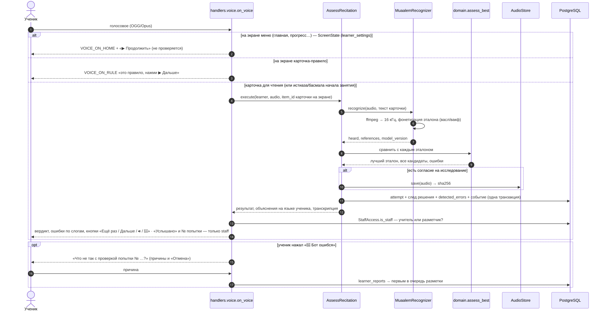

# Архитектура

## 1. Контекст

Ученик общается с ботом в Telegram. Бот берёт уроки из `curriculum/*.yaml`, распознаёт голос
моделью Quran Muaalem, сохраняет результаты в PostgreSQL. Исследователь работает с данными через
CLI `muallim-research`, разметчик получает CSV-очереди.

## 2. Слои

| Слой | Папка | Главные файлы |
|---|---|---|
| domain | `src/muallim/domain/` | `assessment.py` (сравнение фонем, типы ошибок), `policy.py` (пороги), `curriculum.py`, `learner.py`, `attempt.py`, `phonetics.py` |
| application | `src/muallim/application/` | `use_cases/*.py` (сценарии), `ports/*.py` (протоколы), `feedback.py` (тексты ошибок) |
| infrastructure | `src/muallim/infrastructure/` | `db/` (таблицы, репозитории), `asr/` (Muaalem, заглушка), `audio/` (ffmpeg, файлы), `curriculum/` (YAML) |
| presentation | `src/muallim/presentation/telegram/` | `handlers.py`, `keyboards.py`, `views.py`, `texts.py`, `learner.py` |
| research | `src/muallim/research/` | `reports.py`, `annotation.py`, `dataset.py` |
| bootstrap | `src/muallim/bootstrap/` | `config.py`, `di.py` (вся «склейка»), `main.py`, `research_cli.py` |

Правила проверяются автоматически (ADR-0002): `uv run lint-imports`.

### 2.1. Смысловые области

Слои отвечают на вопрос «кто от кого зависит», а области — «о чём этот код» (bounded contexts, DDD).
Одно и то же в разных областях называется по-разному: строка книги в **Обучении** становится эталоном
в **Оценке** и попыткой в **Исследовании**. Поэтому, например, `domain/assessment.py` ничего не знает
об уроках, а отчёты ничего не знают о Telegram.

| Область | За что отвечает | Чего не делает |
|---|---|---|
| Обучение по книге | порядок книги, строки, правила, прогресс, закрепление | не оценивает чтение |
| Эталоны | образец «как правильно»: запись учителя главнее Хусари | не хранит голос учеников |
| Оценка чтения | фонемы → ошибки → вердикт → объяснение по-русски | не знает, кто ученик и что он согласился |
| Ученик и согласие | псевдоним, согласие, удаление; Telegram ID — только здесь | не хранит результатов |
| Исследование | попытка с полным следом решения, жалобы, разметка, отчёты, датасет | не показывает ничего ученику |

Термины областей — `docs/glossary.md`. Как области появлялись — `design-iterations.md`.

## 3. Обработка голосового

## 4. Данные
 — подробно: `docs/data/data-dictionary.md`.

## 5. Как добавить…
| Что | Куда | Пример |
|---|---|---|
| новое правило оценки | `domain/assessment.py` + тест в `tests/unit/test_assessment.py` | новый `ErrorKind` |
| новый сценарий | `application/use_cases/` → зарегистрировать в `bootstrap/di.py` → обработчик | интервальное повторение |
| новую модель | класс с методом `recognize` в `infrastructure/asr/` → выбор в `di.py` | Whisper |
| новый мессенджер / веб | новая папка в `presentation/` | `presentation/web/` |
| поле в БД | `infrastructure/db/tables.py` → `make migration m="..."` → `docs/data/data-dictionary.md` | |
| отчёт | `analytics/sql/NN_название.sql` | |
| урок | `curriculum/course.ru.yaml` (только человек) | |
| язык объяснений | `curriculum/lexicon.<код>.yaml` + `feedback.<код>.yaml`, `enabled: true` | узбекский |
| эталонную запись | `curriculum/audio/<id>.ogg` + строка в `SOURCES.md` | `L02-01.ogg` |

## 6. Технологии
| Что | Чем | Почему |
|---|---|---|
| Язык | Python 3.12 | экосистема ML и aiogram |
| Telegram | aiogram 3 | асинхронный, типизированный |
| DI | dishka | области видимости APP/REQUEST, интеграция с aiogram (SRC-008) |
| БД | PostgreSQL 16 + SQLAlchemy 2 Core + Alembic | ADR-0004 |
| Распознавание | quran-muaalem | SRC-002 |
| Пакеты | uv | быстрый, lock-файл |
| Качество | pytest, ruff, mypy --strict, import-linter, pip-audit, gitleaks | NFR-MNT-*, NFR-SEC-* |

Схемы: исходники `diagrams/*.mmd`, картинки `*.svg`/`*.png` — `make diagrams`.
