# Словарь данных

Описание каждой таблицы и поля. Источник истины — `src/muallim/infrastructure/db/tables.py`;
при изменении схемы обновляется и этот файл (проверяет агент architecture-guardian), и создаётся
миграция. Схема связей: 

**Категории данных:** 🔴 персональные · 🟡 псевдонимизированные · 🟢 не персональные.

## `learners` — ученики
| Поле | Тип | Описание | Кат. |
|---|---|---|---|
| `id` | UUID, PK | внутренний постоянный идентификатор | 🟡 |
| `telegram_user_id` | bigint, уникальный | Telegram ID; **не выгружается** в исследовательские данные | 🔴 |
| `pseudonym` | varchar(16), уникальный | `L-` + 8 hex-символов из `id`; единственный идентификатор в отчётах и датасете | 🟡 |
| `language` | varchar(8) | язык Telegram-клиента (для будущей локализации) | 🟢 |
| `current_item_id` | varchar(32) | открытая карточка, например `L18-01` (id из `curriculum/course.ru.yaml`) | 🟢 |
| `research_consent` | bool | текущее согласие на хранение записей (история — в `consents`) | 🟢 |
| `blocked_bot` | bool | ученик заблокировал бота (зарезервировано) | 🟢 |
| `feedback_language` | varchar(8), null | язык объяснений (ADR-0017); пока только русский — команда /language скрыта (ADR-0022), значение не меняется | 🟢 |
| `created_at` | timestamptz (UTC) | дата регистрации | 🟢 |

## `learner_profiles` — анкета ученика (FR-44, ADR-0038)
Одна строка на ученика, заполняется один раз после согласия на исследование; не перезаписывается.
Удаляется вместе с учеником (CASCADE). Только кнопки — свободного текста нет.
| Поле | Тип | Описание | Кат. |
|---|---|---|---|
| `learner_id` | UUID, PK → learners, CASCADE | чья анкета | 🟡 |
| `adult` | bool | ответ «мне 18+»; `false` — согласие на запись голоса снято, остальное не спрашивалось | 🔴 |
| `native_language` | varchar(8), null | `ru` / `kk` / `tt` / `other`; null у младших 18 | 🔴 |
| `arabic_reading` | varchar(16), null | `none` / `some_letters` / `slow_syllables` — опыт чтения до бота; null у младших 18 | 🟡 |
| `questionnaire_version` | varchar(16) | версия вопросов (`QUESTIONNAIRE_VERSION`) | 🟢 |
| `answered_at` | timestamptz (UTC) | когда ответил | 🟢 |

## `learner_settings` — настройки ученика и состояние экрана (FR-51, TD-FN-90, ADR-0061)
Одна строка на ученика (миграция 0008); нет строки — умолчания, как бот работал до настроек.
Удаляется вместе с учеником (CASCADE). Telegram ID нет — роль просмотра видит таблицу целиком.
Данные работы сервиса, не исследования: согласие на исследование не нужно. Даты — **местные**
(по `utc_offset_min`), время — минуты местных суток. Экрана настроек и рассылки напоминаний пока
нет — поля выбора хранятся с умолчаниями.
| Поле | Тип | Описание | Кат. |
|---|---|---|---|
| `learner_id` | UUID, PK → learners, CASCADE | чьи настройки | 🟡 |
| `how_to_read` | varchar(16), CHECK, по умолч. `spoiler` | «🔤 Как читается»: `spoiler` «Закрыта» / `shown` «Видна сразу» / `hidden` «Не показывать» (ADR-0029) | 🟢 |
| `auto_reference` | bool, по умолч. false | присылать эталон голосовым перед карточкой (В5) | 🟢 |
| `daily_opening` | bool, по умолч. true | предлагать начало занятия — истиаза и басмала (ADR-0050) | 🟢 |
| `large_font` | bool, по умолч. false | крупный шрифт картинок (ADR-0059) | 🟢 |
| `research_block` | bool, по умолч. false | показывать блок «Для исследования» (ADR-0057) | 🟢 |
| `reminder_minute` | smallint, null, CHECK 0…1439 | минута местных суток для напоминания; null — выключено | 🟢 |
| `utc_offset_min` | smallint, CHECK −720…840, по умолч. 180 | смещение от UTC в минутах по ответу «который у тебя час?»; до ответа — UTC+3 (В3). Не город и не геопозиция | 🟡; 180 у ученика, который не отвечал, — умолчание, а не его часовой пояс. Не выгружается в датасет и отчёты (ADR-0061) |
| `screen_item_id` | varchar(32), null | карточка на экране; null — меню (голосовое не оценивается, FR-50) | 🟢 |
| `screen_opening` | bool, по умолч. false | карточка открыта как шаг начала занятия | 🟢 |
| `opening_resume_item` | varchar(32), null | куда вернуться после басмалы; null — начала занятия нет | 🟢 |
| `opening_day` | date, null | местная дата начала занятия: вчерашнее не действует | 🟢 |
| `opening_skipped_on` | date, null | местная дата «Пропустить» — сегодня больше не предлагать | 🟢 |
| `reminder_sent_on` | date, null | местная дата последнего напоминания (не больше одного в день) | 🟢 |
| `updated_at` | timestamptz (UTC) | последнее сохранение | 🟢 |

## `consents` — журнал согласий
Каждое «да»/«нет» — новая строка; ничего не перезаписывается.
| Поле | Тип | Описание |
|---|---|---|
| `id` | int, PK | |
| `learner_id` | UUID → learners, CASCADE | |
| `kind` | varchar(32) | сейчас только `research_audio` |
| `granted` | bool | дал / отозвал |
| `text_version` | varchar(32) | версия текста согласия (`CONSENT_TEXT_VERSION`) |
| `at` | timestamptz | когда |

## `attempts` — попытки чтения (основная единица данных)
| Поле | Тип | Описание |
|---|---|---|
| `id` | UUID, PK | |
| `learner_id` | UUID → learners, CASCADE | |
| `item_id` | varchar(32) | карточка из `curriculum/course.ru.yaml` |
| `curriculum_version` | varchar(32) | `version` из YAML на момент попытки |
| `model_version` | varchar(128) | пакет модели, версия и параметры чтения; `stub` — заглушка, исключается из отчётов |
| `reference_phonemes` | text | эталон, по которому оценено (лучший из вакф/васл) |
| `heard_phonemes` | text | что распознала модель |
| `score` | smallint 0–100 | сходство последовательностей фонем (`difflib.SequenceMatcher.ratio`) |
| `verdict` | varchar(16) | `excellent` / `passed` / `failed` (пороги — `domain/policy.py`) |
| `audio_sha256` | varchar(64), null | хеш записи; `null` — согласия не было |
| `audio_duration_ms` | int, null | длительность записи |
| `processing_ms` | int | время распознавания и оценки (NFR-PERF-01) |
| `created_at` | timestamptz | |
| `reference_variant` | varchar(16), null | по какому эталону оценено: `wasl` / `waqf` (ADR-0019) |
| `candidates` | JSON, null | все эталоны: `[{"variant", "reference", "score"}]` |
| `model_output` | JSON, null | сырые данные модели сверх строки фонем (для отладки и дообучения): `phonemes` — строка; `phonemes_full` — `{"text", "probs": [числа], "ids": [числа]}`, уверенность по каждой фонеме; `sifat_full` — список `{"phonemes_group", <признак>: {"text", "prob", "idx"} \| null}`. У попыток до 2026-10-23 `phonemes_full`/`sifat_full` — строка `repr()` с `tensor(…)` (TD-FN-99); у `tikraar` модель отдаёт `prob = 2.0` — не вероятность |
| `policy` | JSON, null | пороги на момент решения: `{"pass_threshold", "excellent_threshold"}` |
| `app_version` | varchar(64), null | версия кода: `0.2.0+a1b2c3d[-dirty]` |
| `feedback_language` | varchar(8), null | на каком языке показано объяснение |

Поля следа решения пусты у попыток до миграции 0002.

## `curriculum_items` — снимок учебной программы (ADR-0023)
Пишется ботом при старте: одна строка на карточку каждой версии программы. Нужен, чтобы любую
попытку связать со страницей и строкой книги и с тем текстом, который видел ученик, даже после
правок `course.ru.yaml`. Если контент изменён без новой `version`, бот не запустится.

| Поле | Тип | Описание | Кат. |
|---|---|---|---|
| `curriculum_version` | varchar(32), PK | версия программы (= `attempts.curriculum_version`) | 🟢 |
| `item_id` | varchar(32), PK | id карточки (= `attempts.item_id`) | 🟢 |
| `lesson_id` | varchar(16) | урок, `L18` | 🟢 |
| `lesson_number` | smallint | номер урока по порядку книги | 🟢 |
| `lesson_title` | varchar(128) | название урока, как в меню бота | 🟢 |
| `position` | smallint | номер карточки в уроке, с 1 | 🟢 |
| `kind` | varchar(16) | `letter` / `line` / `word` | 🟢 |
| `text` | text | арабский текст карточки | 🟢 |
| `note` | text | пометка книги, например «Обратите внимание: пары похожих слов» | 🟢 |
| `source_id` | varchar(16), null | источник, `SRC-040` | 🟢 |
| `page` | smallint, null | страница книги | 🟢 |
| `line` | smallint, null | строка на странице (`book/README.md`) | 🟢 |
| `verified` | boolean | сверено человеком с книгой | 🟢 |
| `published_at` | timestamptz | когда версия впервые записана в БД | 🟢 |

## Представления (views) для просмотра — `src/muallim/infrastructure/db/views.py`
Только чтение. Telegram ID в них нет — только псевдоним. Открывать в DBeaver, VS Code (расширение PostgreSQL), psql или `notebooks/db.py` (`docs/data/browsing.md`, `docs/data/sql-guide.md`). Здесь — главные поля; все колонки — в `views.py`.

| Представление | Строка = | Главные поля |
|---|---|---|
| `v_attempts` | попытка | `pseudonym`, `item_id`, `lesson_id`, `page`, `line`, `item_text`, `item_note`, `score`, `verdict`, `errors`, `disputed`, `annotations`, `audio_sha256`, `model_version` |
| `v_errors` | найденная ошибка | `pseudonym`, `item_id`, `page`, `line`, `item_text`, `kind`, `expected`, `heard`, `position`, `syllable`, `message`, `score`, `label` (последняя метка попытки, не этой ошибки; ADR-0055), `disputed`, `audio_sha256` |

## `detected_errors` — ошибки, найденные системой
| Поле | Тип | Описание |
|---|---|---|
| `id` | int, PK | |
| `attempt_id` | UUID → attempts, CASCADE | |
| `ordinal` | smallint | порядок в ответе ученику |
| `kind` | varchar(32) | тип из `domain.assessment.ErrorKind`: `letter_substitution`, `vowel_substitution`, `sound_substitution`, `fragment_substitution`, `madd_too_short`, `vowel_missing`, `shadda_missing`, `sound_missing`, `madd_too_long`, `extra_sound` |
| `position` | smallint | индекс в `reference_phonemes` |
| `syllable` | smallint, null | номер слога; `null` для односложных карточек |
| `expected` / `heard` | varchar(16) | что должно было прозвучать / что прозвучало |
| `message` | text | полное объяснение каждой ошибки (`feedback.<язык>.yaml`); ученику с FR-54 не показывается — на экране разбор группами (ADR-0070) |

## `annotations` — разметка человеком
| Поле | Тип | Описание |
|---|---|---|
| `id` | int, PK | |
| `attempt_id` | UUID → attempts, CASCADE | |
| `annotator` | varchar(64) | **код** разметчика (A1, T2), не имя; латиница, цифры, `-`, `_` |
| `label` | varchar(32) | с 2.0: `agree` (бот услышал верно), `fix` (исправлено), `audio_unusable`, `off_task`; метки 1.0 (`correct`, `false_alarm`, …) в метрики не входят |
| `corrected_phonemes` | text, null | что прозвучало на самом деле (Quran Phonetic Script): при `agree` — то, что услышал бот, при `fix` — исправленное; `null` — `audio_unusable` / `off_task` |
| `comment` | text | |
| `guide_version` | varchar(16) | версия руководства по разметке |
| `created_at` | timestamptz | |
| `source` | varchar(16), null | откуда метка: `excel` (пакет `tasks.csv`) или `telegram` (кнопки в боте, FR-17); `null` — метки до миграции 0005 (все из Excel) |
| `seconds_spent` | int, null | секунд от показа записи до ответа — только Telegram; при исправлении фонем — до отправки исправления |
| `self_corrected` | boolean, null | ученик ошибся и сам перечитал верно — отдельная категория (руководство 2.1, ADR-0043); только при `agree`/`fix`; `null` — метки до миграции 0006 (не спрашивали) |

Строки не изменяются и не удаляются при исправлении: исправленная метка — новая строка, в
метриках и датасете берётся **последняя метка каждого разметчика** на попытку (история
сохраняется). Удаляются вместе с попыткой (CASCADE) и при отзыве согласия на запись голоса.

## `annotators` — разметчики по приглашению, вошедшие по `/annotate` и отозванные (FR-17, ADR-0041, ADR-0072)
| Поле | Тип | Описание |
|---|---|---|
| `code` | varchar(64), PK | код разметчика (A1, A2…), не имя; при входе по `/annotate` — следующий номер, коды не переиспользуются |
| `telegram_user_id` | bigint, unique, null | привязан приглашением или входом по `/annotate`; **персональные данные** — только для проверки доступа, в выгрузки не попадает |
| `created_at` | timestamptz | |
| `revoked_at` | timestamptz, null | доступ закрыт (`muallim-research annotator-revoke`); действует и на разметчиков из `ANNOTATOR_IDS` |

Разметчики из `ANNOTATOR_IDS` (настройки) здесь не хранятся, пока их не отзовут.

## `annotator_invites` — приглашения в разметку (FR-17, ADR-0041)
| Поле | Тип | Описание |
|---|---|---|
| `id` | int, PK | |
| `code_digest` | varchar(64), unique | SHA-256 кода приглашения (без регистра, дефисов и пробелов); **сам код не хранится** |
| `annotator` | varchar(64) | для какого кода разметчика |
| `created_at`, `expires_at` | timestamptz | действует сутки |
| `used_at` | timestamptz, null | погашено при входе (один раз); неиспользованные удаляются при отзыве |

## Ограничения в самой БД (ADR-0055)
- `attempts.verdict` ∈ excellent / passed / failed; `annotations.label` ∈ agree / fix / audio_unusable / off_task и метки 1.0 (correct, false_alarm, missed_error, wrong_error); `annotations.source` ∈ excel / telegram или NULL; `learner_reports.reason` ∈ read_correctly / wrong_error / other.
- Уникально: `detected_errors(attempt_id, ordinal)`; `learner_reports(attempt_id, learner_id)` — одна жалоба ученика на попытку.
- `annotations.detected_error_id` удалено миграцией 0007.
- `learner_settings` (миграция 0008): `how_to_read` ∈ spoiler / shown / hidden; `reminder_minute` NULL или 0…1439; `utc_offset_min` −720…840; одна строка на ученика (PK `learner_id`).

## `learner_reports` — жалобы «бот ошибся» (ADR-0020)
| Поле | Тип | Описание |
|---|---|---|
| `id` | int, PK | |
| `attempt_id` | UUID → attempts, CASCADE | оспоренная попытка |
| `learner_id` | UUID → learners, CASCADE | кто оспорил (только свою попытку) |
| `reason` | varchar(32) | `read_correctly` / `wrong_error` / `other` |
| `created_at` | timestamptz | |

## `quiz_answers` — ответы «🧠 Закрепления» (FR-53, ADR-0066, миграция 0009)
Одна строка — один показанный вопрос: пишется при показе, ответ дописывается в неё же один раз
(повторное нажатие — «кнопка устарела»). Строка без ответа (`answered_at` NULL) — вопрос показан, но не
отвечен; `answered_at` есть, а `correct`, `picked`, `attempt_id` — NULL: пропущен кнопкой «Не могу сейчас
говорить/слушать» (не ошибка). `answered_at − shown_at` у вопроса, к которому вернулись позже, может быть в днях. Ступени
и сроки повторения не хранятся — вычисляются из этих строк (`domain/quiz.py`, M-19).
| Поле | Тип | Описание |
|---|---|---|
| `id` | UUID, PK | его `hex` — в кнопке ответа (`qa:<id>:<вариант>`) |
| `learner_id` | UUID → learners, CASCADE | удаляется вместе с учеником |
| `round_no` | int | номер раунда ученика (1, 2, …); `UNIQUE (learner_id, round_no, position)` — одно место, один вопрос |
| `position` | smallint ≥ 1 | место в раунде (1–10, `QUIZ_ROUND`) |
| `step` | smallint 1–3 | ступень: 1 — узнаю (кириллица), 2 — слышу (🔊 → арабский слог), 3 — читаю голосом |
| `letter_id` | varchar(32) | буква — id головной карточки урока (`L007-05` = ت); для модели усвоения (RQ-3) |
| `item_id` | varchar(32) | что было на экране: слог (`L007-03`) на ступенях 1–2, строка буквы на 3 |
| `vowel` | smallint 0–2 | огласовка: 0 фатха, 1 кясра, 2 дамма |
| `options` | JSON | варианты в том порядке, как показаны; на ступени 3 — пусто |
| `answer` | smallint | индекс верного варианта; на ступени 3 — −1 |
| `picked` | smallint 0–3, NULL | что нажал ученик; NULL — не отвечал или ступень 3 |
| `correct` | bool, NULL | верно ли; на ступени 3 — вердикт попытки не `failed` (M-01); NULL — не отвечен или пропущен |
| `attempt_id` | UUID → attempts, SET NULL | попытка чтения на ступени 3 |
| `reason` | varchar(16) | почему выбран вопрос: `retry`, `due`, `mistake`, `new`, `old` |
| `shown_at` | timestamptz | когда показан |
| `answered_at` | timestamptz, NULL | когда ответил; время ответа = `answered_at − shown_at` |
| `curriculum_version` | varchar(32) | версия программы при показе |
| `rule` | varchar(8) | версия правила отбора (`v2` — ADR-0066) |

## `interaction_events` — журнал действий
| Поле | Тип | Описание |
|---|---|---|
| `id` | int, PK | |
| `learner_id` | UUID → learners, SET NULL | после удаления ученика событие остаётся обезличенным |
| `event` | varchar(48) | `learner_registered`, `consent_changed` (payload: `granted`, `audio_deleted`), `item_opened`, `attempt_assessed`, `recognition_failed` (payload: `item_id`, `stage` = `decode` / `model`, `processing_ms`; без текста ошибки), `reference_played`, `reference_recorded`, `video_played` (ролик «🎬 Как произносить», FR-56, ADR-0074; payload: `video` — ключ ролика (имя mp4 без расширения из `curriculum/video/videos.yaml`), `item_id` карточки, `from` = `card` / `auto` / `after` (`breakdown` / `sheet` и `letter` — только со старых кнопок; ролики там больше не показываются, ADR-0074); только после успешной отправки в Telegram), `attempt_disputed`, `quiz_skipped` (payload: `letter_id`, `item_id`, `step`, `position`), `quiz_answered` (payload: `letter_id`, `item_id`, `step`, `vowel`, `position`, `correct`; до ADR-0066 — `item_id`, `vowel`, `correct`; источник правды — `quiz_answers`), `feedback_language_set`, `learner_deleted`; разметка (FR-17, `learner_id` — сам разметчик): `annotation_shown`, `annotation_submitted` (payload: `annotator`, `attempt_id`, `status`), `annotator_invite_redeemed`, `annotator_invite_failed` (для ограничения подбора кода) |
| `payload` | JSON | только ID карточек, баллы, флаги; **никогда** — текст сообщений |
| `created_at` | timestamptz | |

## Вне БД
| Что | Где | Описание |
|---|---|---|
| Аудиозаписи | `data/audio/<2 символа>/<sha256>.ogg` | оригинал из Telegram (OGG/Opus), права 0600 |
| Учебная программа | `curriculum/course.ru.yaml` | версия → `attempts.curriculum_version` |
| Объяснения на языках | `curriculum/lexicon.<язык>.yaml`, `curriculum/feedback.<язык>.yaml` | язык → `attempts.feedback_language` |
| Эталонные записи | `curriculum/audio/<id>.ogg` | источник — `curriculum/audio/SOURCES.md` |
| Аяты по слогам (FR-61, ADR-0077) | `curriculum/syllables/ayat.yaml` | генерирует `make syllables` (`scripts/syllables/`); строка — точный текст пункта урока «Суры», `status` (`unchecked` / `ok` / `bad`, ставит человек), `words` — клетки [кусочек, подпись]; `moshaf` — `MOSHAF_PARAMS`. **Не входит в `curriculum.version`**: какую карточку видел ученик, по попытке не восстановить (TD-FN-120) |
| Пакеты разметки | `data/annotation/<код>_<дата>/` | `tasks.csv` (UTF-8 с BOM) + `audio/` — копии голосов; удалить после загрузки |
| Выгрузки датасета | `data/exports/<дата>/` | `manifest.jsonl` + `truth.csv`/`predictions.csv` (Iqra'Eval) + `phonemes.csv` (итог по каждому звуку для каждого разметчика, ADR-0056; `docs/data/browsing.md`) + `audio/` |
| Журнал удалений | `data/erasures/erasures.jsonl` | вне БД (ADR-0054): строка — время UTC, `delete` / `withdraw` / `grant`, UUID ученика; пишется до commit, повторяется после восстановления |
| Резервные копии | `data/backups/<дата>/` | `db.dump` + `audio.tar.gz` + `erasures.jsonl` + `SHA256SUMS`; неудачная — с суффиксом `-FAILED` |
