# Жизненный цикл данных

| Этап | Что происходит | Где | Кто имеет доступ |
|---|---|---|---|
| Сбор | голосовое → распознавание → попытка и ошибки в БД; аудио — только с согласия | бот | бот |
| Хранение | PostgreSQL + файлы `data/audio/` на сервере | сервер (OQ-08) | исследователь |
| Разметка | пакет (`tasks.csv` + записи) → `agree`/`fix` и что прозвучало → `annotations`; размечают оба | у исследователя и разметчика (зашифрованная флешка; удалить после загрузки) | исследователь, разметчик (записи, фонемы, ответ бота; без псевдонима) |
| Анализ | `muallim-research report` → `analytics/reports/*.md` | репозиторий | исследователь, руководитель |
| Датасет | `muallim-research dataset-export` → `data/exports/<дата>/` | локально; **не** в git | исследователь |
| Удаление | ученик: /privacy → «Удалить»; запись в журнал удалений `data/erasures/` до commit, каскад в БД, затем файлы; после восстановления копии журнал повторяется (ADR-0054). Отзыв согласия — записи и разметка по ним (ADR-0040); копии в пакетах и выгрузках показывает `make verify` | бот, исследователь | ученик |
| Окончание исследования | *предложение, утвердить в OQ-01:* аудио удаляется через 12 мес. после защиты | сервер | исследователь |

## Воспроизводимость датасета
Каждая выгрузка — отдельная папка с датой; `manifest.jsonl` содержит `attempt_id`, `audio_sha256`,
`model_version` и `curriculum_version`. Для статьи/диссертации фиксируйте имя папки выгрузки и
git-коммит, на котором она сделана (OQ-06 — переход на DVC/audb).
