# Как вести разработку

## Цикл изменения (TDD, ADR-0011)

1. **Задача.** Сформулировать, к какому требованию (FR/NFR) относится; если требования нет — сначала
   добавить в `docs/requirements/requirements.md`.
2. **Красный.** `scripts/phase tests` → тесты, которые падают по правильной причине. Человек их читает.
3. **Зелёный.** `scripts/phase impl` → минимальный код до зелёного `make check`. Тесты заморожены.
4. **Рефакторинг.** Улучшить код при зелёных тестах.
5. **Документы.** CHANGELOG, ADR (если решение архитектурное), матрица трассировки, словарь данных.
6. **Конец.** `scripts/phase off` → проверка в Telegram → коммит.

## Готово, когда (Definition of Done)
- [ ] `make check` зелёный: ruff, mypy --strict, import-linter, pytest с покрытием ≥ 80 %
- [ ] требование отмечено в `requirements.md`, строка в `traceability.md`
- [ ] изменение схемы БД → миграция + `data-dictionary.md`
- [ ] архитектурное решение → ADR (и отклонённые варианты в нём)
- [ ] запись в `CHANGELOG.md` (раздел «Не выпущено»)
- [ ] видимые ученику тексты/контент утверждены человеком

## Git
- Ветка на задачу: `feat/…`, `fix/…`, `docs/…`.
- Сообщения коммитов — Conventional Commits: `feat(assessment): ...`, `docs(adr): ...`.
- В сообщении — ID требования: `Refs: FR-15`.
- Коммитит и пушит **только человек** (агенту — запрещено настройками).
- Версии: `vMAJOR.MINOR.PATCH` (SemVer); тег при каждом пилоте с учениками — чтобы данные можно
  было сопоставить с кодом.

## Команды
| Команда | Что делает |
|---|---|
| `make setup` | зависимости + pre-commit |
| `make check` | все проверки как в CI |
| `make test` | только тесты |
| `make db-up` / `make migrate` | поднять PostgreSQL в Docker / применить миграции (копия БД + upgrade входом владельца) |
| `make db-roles` | три входа в БД (владелец, бот, просмотр), пароли в .env — только человек, ADR-0054 |
| `make run-stub` | бот без модели (заглушка распознавания); перед стартом `db-sync` |
| `make run` | бот с моделью (нужно `uv sync --extra ml`); перед стартом `db-sync` |
| `make db-sync` | БД не на последней миграции → `make migrate` (копия БД + upgrade входом владельца); иначе ничего |
| `make report` | отчёт по данным |
| `make diagrams` | перерисовать схемы |
