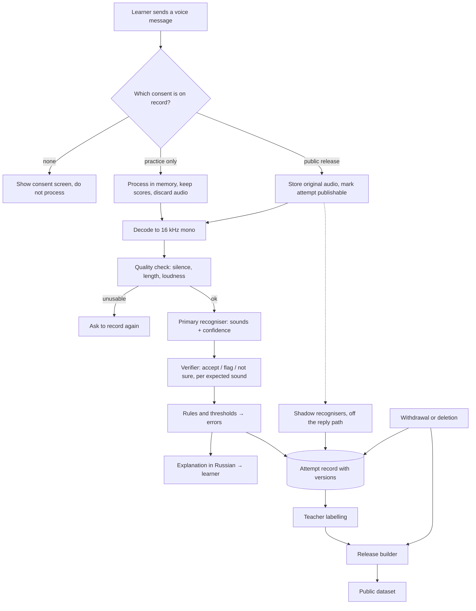
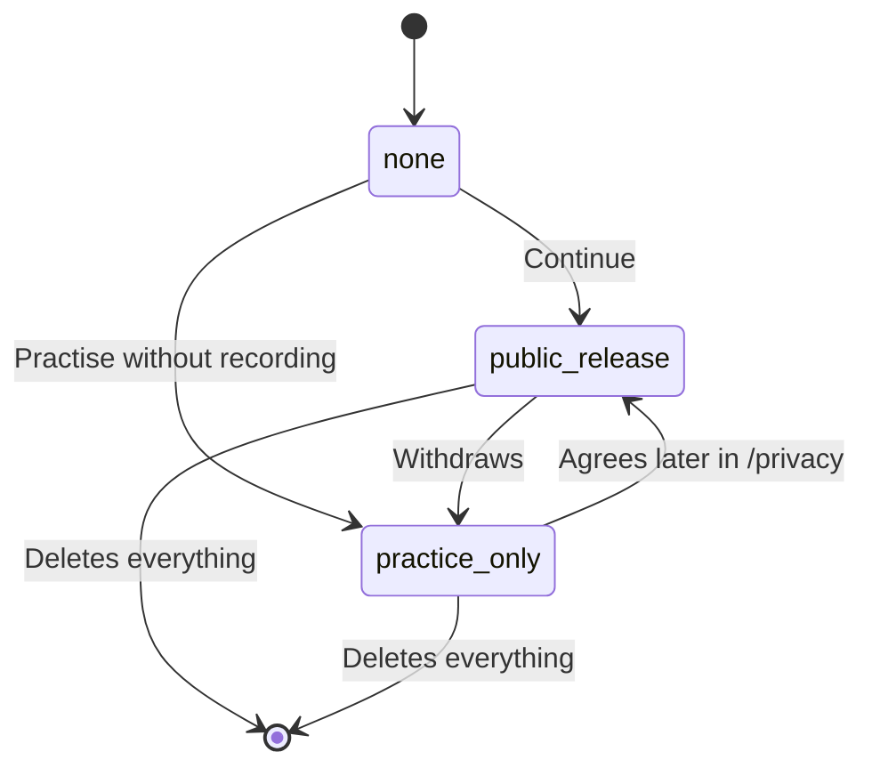

# Phase 5 — Muallim Architecture and Public Consent

**Project:** Muallim (Telegram reading trainer, textbook *al-Muallim ath-Thani*)
**Date:** 2026-11-17
**Status:** proposal. No code, database schema, learner-facing text or setting was changed. Phase 3 (running models) was skipped, so the architecture is designed to compare recognisers on real data rather than to fix one.
**Update (2026-11-17):** a preliminary Phase 3 test was run later (`PHASE_3_EXPERIMENTAL_RESULTS.md`). No model was best on single letters, which supports the design below: several recognisers compared on the same attempts.
**Builds on:** `PHASE_1_ASR_RESEARCH.md`, `PHASE_2_DATASET_RESEARCH.md`, `PHASE_4_DATASET_SPECIFICATION.md`.

> **This is not legal advice.** The legal findings below come mostly from commentary by law firms and compliance sites, which contradict each other on dates and details. They show which questions must be answered, not the answers. The university's ethics body and, for publication, a lawyer must confirm them.

---

## 1. Summary

1. **Telegram's own rules require explicit consent for what Muallim does.** The Bot Platform developer terms prohibit "any form of data collection aimed at creating large datasets, machine learning models" and AI products. Data that users submit themselves may be used only if they are told clearly how and give "individual, explicit, active and revocable consent". Building a dataset from voice messages without such consent risks the bot being banned.
2. **The proposal to drop the consent screen (ADR-0085) cannot be combined with a public dataset.** A notice line without a button is not "explicit" or "active". The author's newer requirement — the learner presses «Продолжить» after being told the recordings become public — is the right direction.
3. **A voice cannot be made anonymous, and a published copy cannot be recalled.** The consent text must say both in plain words. No comparable dataset found in Phase 2 documents its consent; doing so is part of Muallim's contribution.
4. **Where the server stands is a legal question, not only a technical one.** Commentary on Kazakhstan's law says personal data must be stored on servers in Kazakhstan; commentary on Russia's law says first collection of Russian citizens' data must go to a database in Russia. Publishing on Hugging Face is a cross-border transfer on top of that. The project's open question OQ-08 (where to host) decides which rules apply.
5. **Recommended consent design:** one clear screen before the first recording; «Продолжить» means agreement to public release; a second, smaller option lets a person practise without sharing. Learners under 18 use the bot but their recordings are not published.
6. **Recommended licence design:** gated access on Hugging Face with usage terms that forbid identifying speakers, cloning voices and redistributing the audio, and oblige users to honour removals.
7. **Recommended architecture:** keep the existing layered design; add a second, independent "verifier" step and a shadow mode so that several recognisers can be compared on the same attempts without changing what the learner sees.

Decisions about consent wording, licence, minors, database schema and hosting belong to the author under project rules. Each is presented below as options with a recommendation.

### Evidence marks

| Mark | Meaning |
|---|---|
| **[P]** | Read in a primary source in this session (official terms, documentation, project files) |
| **[S]** | Secondary source (law-firm or compliance commentary, search summary) — must be confirmed |
| **[?]** | General knowledge, not checked in this session |

---

## 2. Where the project stands today

| Topic | Current state | Source |
|---|---|---|
| Consent | A screen "Участие в исследовании" with buttons «Да, разрешаю» / «Нет». It covers *storing* recordings for research. It says recordings are heard "only by researchers". The bot works without consent. | `texts.py`, `docs/security/privacy.md` [P] |
| Consent record | Every yes/no is a new row with the version of the text | table `consents` [P] |
| Withdrawal | `/privacy`: withdraw (recordings and their labels are deleted, scores stay) or delete everything; a deletion journal outside the database replays removals after a restore | `privacy.md`, ADR-0040, ADR-0054 [P] |
| Identity | Internal code `L-…`; name kept in a separate table; Telegram ID never exported | data dictionary [P] |
| Minors | The questionnaire has an "under 18" band; the author decided to record their voices; parental consent is noted as the author's task before publication | `privacy.md`, ADR-0081 [P] |
| Sensitive answers | The questionnaire asks about prayer (religious practice) | data dictionary [P] |
| Proposed change | ADR-0085 (status: proposed): no consent screen, recordings always saved, learner shown by name to the teacher; the agent recommended keeping at least a notice line | ADR-0085 [P] |
| Open questions | OQ-01 ethics approval and consent text; OQ-08 hosting country | `open-questions.md` [P] |
| Speech recognition | One recogniser (Muaalem) behind a replaceable interface; raw output stored with every attempt | architecture overview [P] |

**Conflict to resolve first.** The current consent promises that only researchers hear the recordings. A public dataset breaks that promise. Recordings made under the current text cannot be published unless the learner later accepts a new text that says so.

---

## 3. Architecture for speech recognition

### 3.1 Design goals

| Goal | Reason |
|---|---|
| No recording is stored or used beyond what the learner agreed to | Telegram terms; law; trust |
| The learner gets feedback from one stable system while others are evaluated silently | Phase 3 was not run; ADR-0051 already plans a shadow mode |
| Stage I (single letters) and Stage II (words) can use different mechanisms | Phase 1, section 8 |
| Every decision can be reproduced later | Already a project principle (ADR-0019) |
| A withdrawal reaches every copy we control | Law; consent promise |

### 3.2 Flow of one voice message

### 3.3 Components

| Component | Exists | Proposal |
|---|---|---|
| Voice download and decoding (ffmpeg) | Yes | Unchanged |
| Consent gate before any storage | Partly (storage consent) | Three states instead of two: none, practice only, public release (section 6) |
| Quality check | Partly | A voice-activity check before recognition; Phase 2 found 25 % invalid recordings in a comparable crowd dataset. A reference implementation is already in `external/` |
| Primary recogniser | Yes (Muaalem behind a port) | Unchanged until an experiment shows a better one |
| **Verifier** | No (planned as B1 in ADR-0051) | A separate step that scores each expected sound against alternatives and may answer "not sure" (Phase 1, section 5a). For single letters it can instead be a closed-set classifier or a comparison with the teacher's recording |
| **Shadow recognisers** | No (planned in ADR-0051) | Further recognisers run after the reply is sent, on publishable attempts only, and write their output beside the primary one. The learner never sees them |
| Rules, thresholds, explanation | Yes | Unchanged |
| Attempt record | Yes | Add which consent applied and, per shadow model, its output (schema change — author decides) |
| Labelling by teachers | Yes | Record whether the label was blind (Phase 4, gap 6) |
| **Release builder** | Partly (`dataset.py` export) | Applies the Phase 4 rules: only publishable attempts, release speaker codes, no sensitive fields, checksums, changelog |
| **Withdrawal propagation** | Partly (internal deletion and journal) | Extend to releases: removal list for the next version, notice to registered dataset users |

### 3.4 Options for the recogniser design

| Option | Advantages | Disadvantages | Assessment |
|---|---|---|---|
| A. Keep one model, improve rules only | Nothing new to run; smallest change | Cannot fix the model's "hears the rule, not the learner" bias; no evidence for the thesis comparison | Not enough for RQ-2 |
| **B. One primary model + verifier + shadow models** | Learner experience stays stable; every candidate from Phase 1 can be measured on real attempts; matches ADR-0051 | More computation per attempt; more to store | **Recommended** |
| C. Replace the primary model now with a Phase 1 candidate | Possibly better detection | No measurement supports any replacement (Phase 3 skipped); the most promising candidate has licence and access problems | Premature |
| D. Send audio to a commercial service | No model hosting | Audio leaves our control; no Arabic sound labels (Phase 1); extra consent and cross-border issues | Not recommended |

### 3.5 Hosting and load

| Question | Finding |
|---|---|
| Hardware for the bot | The primary model (0.6B parameters) already runs. Shadow models of 20–300M parameters add little; they run after the reply and may be queued. |
| Development machine (M1 Air, 8 GB) | Enough for development and for small shadow models one at a time; not for training (Phase answer of 2026-11-16) |
| Server location | Decides which data law applies (section 5.2). A server in the learners' country is the conservative choice. Open question OQ-08 |
| Fallback when the model fails | Already handled: the learner is asked to try again; no audio is lost silently |

---

## 4. What "public" changes

| Fact | Consequence |
|---|---|
| A voice identifies a person to anyone who knows them, and increasingly to software | "Anonymous" must not be promised. Say: without your name, but your voice can be recognised |
| Published files can be copied by anyone who downloaded them | Withdrawal removes the recording from our storage and from future versions, not from copies already taken. This must be said before consent, not after |
| Recordings can be used to imitate a voice | Usage terms should forbid it; the consent text should mention the risk honestly |
| Reading aloud from a religious primer may reveal religious affiliation | Treat the whole dataset, not only the prayer question, as potentially sensitive |
| Hugging Face stores data outside the learners' countries | Publication is a cross-border transfer; consent must name it |

---

## 5. Requirements found

### 5.1 Telegram (primary source, read in this session)

| Requirement | Text or paraphrase | Effect on Muallim |
|---|---|---|
| Privacy policy | Bots "must be bound by a privacy policy that is easily accessible to their users", stating what is stored, how and why; a custom one is set through @BotFather | Write a policy and register it; `/privacy` alone is not enough |
| Data minimisation | Do not collect or store "beyond what is essential for the operation" of the service | Research and publication are *not* essential to the service, so they need consent |
| Datasets and AI | "Always prohibited uses include any form of data collection aimed at creating large datasets, machine learning models" and AI products | The default is prohibition |
| The exception | Data users submit directly may be used if its intended use is clearly stated and the user gives "individual, explicit, active and revocable consent" | This is the legal basis for the dataset on Telegram's side. A notice line without a button does not meet it |
| Deletion | Delete user data on the user's request, when no longer needed, and when the bot stops operating (unless users agreed to retention) | Already supported internally; state retention after the project ends in the consent |
| Changes | Users must be told of significant changes and given the chance to opt out | Switching from "researchers only" to "public" is such a change |
| Sanction | Violation "may lead to the immediate termination of your account" or the bot | A banned bot ends the pilot |

Source: Telegram Bot Platform Developer Terms of Service, sections 4–5 [P]. The page shows no date.

### 5.2 Data-protection law (secondary sources — to be confirmed)

| Topic | Kazakhstan (Law No. 94-V) | Russia (152-FZ) | EU GDPR, as a reference standard |
|---|---|---|---|
| Voice | Personal data. The definition of biometric data was removed from the law in 2026; biometric rules moved to the Digital Code and concern authentication [S] | Personal data; biometric rules apply when used to identify a person [S, unclear] | Personal data; "special category" only when processed to uniquely identify a person [S] |
| Basis | Consent, or one of a closed list of grounds; no "legitimate interest" [S] | Consent among other grounds; one source says consent must be a separate document from 1 September 2025 [S, unconfirmed] | Consent must be freely given, specific, informed, unambiguous; explicit for special categories [S] |
| Withdrawal | Processing must stop within 15 working days of withdrawal [S] | Not found | As easy as giving consent [?] |
| Storage location | Personal data must be stored on servers in Kazakhstan (Article 12(2)), with no exemption by size [S] | First collection of Russian citizens' data must be in a database in Russia (in force from 1 July 2025) [S] | No localisation rule [?] |
| Transfer abroad | Allowed with the person's consent if the destination's protection is not established; localisation still applies [S] | Notification of the regulator; rules for "non-adequate" countries; list of countries under revision in 2026 [S, conflicting] | Allowed with safeguards or explicit consent [?] |
| Registration | Only operators with 500,000+ people must notify (from 25 August 2026) [S] | Operators generally notify the regulator [?] | — |
| Published data | From 25 August 2026, a person's own publication of data is not consent to further use by others [S] | Not found | — |
| Minors | Not found | Not found | Parental consent below an age set nationally, 13–16 [?] |
| Penalties | Fines up to several million tenge for organisations; criminal liability for serious harm [S] | Higher fines from 2025, criminal article on illegal handling of data [S] | — |

Sources: commentary pages listed at the end. They disagree on several dates; none is an official text.

Which law applies depends on where the operator is, where the server is and where learners live. If learners come from several countries, the strictest relevant rule should be followed.

### 5.3 Practice in other voice projects

| Project | Practice | Lesson | Evidence |
|---|---|---|---|
| Mozilla Common Voice | CC0 public-domain release; deletion on request through a form; "it may not be possible to honor all deletion requests"; deleting the account first makes recordings unfindable | Keep the private link between person and recordings, or withdrawal becomes impossible; be honest about limits | [P] Mozilla support page |
| Kyutai voice donation | Two separate consents: one for training the organisation's models, one for an open dataset; keeps one contact detail to handle requests; binds dataset users to lawful processing | Separate the purposes; bind downstream users | [S] |
| SOPHIAS (student presentations) | Not treated as anonymous because it contains voices; access under a data-use agreement that forbids redistribution, including derived data; withdrawal reviewed case by case | Controlled access makes withdrawal meaningful | [S] |
| Finnish speech corpus licence | Forbids combining recordings with other personal data and comparing recordings to tell whether two speakers are the same person | Model clause against re-identification | [S] |
| TWB Voice | Consent form explains use, review process, right to deletion and to withdraw; two steps: platform terms, then a specific voice consent | Specific consent separate from general terms | [P] playbook page |
| Arabic datasets of Phase 2 | No consent procedure described in any | Documenting ours is a contribution | Phase 2, section 5a |

### 5.4 Hugging Face access control (primary source)

- A dataset can require an access request; approval is automatic or manual. [P]
- The owner can show its own conditions and ask for fields, including checkboxes the requester must tick. [P]
- The owner receives each requester's username and email (unless switched off) and can download the list. [P]
- Access can be rejected or reset at any time; a reset forces the user to accept the terms again. [P]

This gives two things an ordinary open download lacks: recorded acceptance of usage terms, and a list of people to notify when a learner withdraws.

---

## 6. Decisions and options

### 6.1 Consent model

| Option | How it works | Advantages | Disadvantages | Assessment |
|---|---|---|---|---|
| A. Notice line, no button (ADR-0085 as written) | Using the bot counts as agreement | No extra step | Not "explicit" or "active" (Telegram); weak under every law reviewed; nothing to show an ethics body | **Not acceptable for a public dataset** |
| B. One gate: «Продолжить» = public release; otherwise the bot cannot be used | Everyone who studies contributes | Maximum data; simplest to explain | Consent tied to access to the service is open to challenge as not freely given; excludes cautious people and minors | Possible, but weaker |
| **C. «Продолжить» = public release, plus a smaller «Заниматься без записи»** | The main button agrees; the second lets a person practise with nothing stored | Consent is clearly voluntary; meets Telegram's wording; still one screen; matches the present principle "the bot works without consent" | Some learners will choose not to share | **Recommended** |
| D. Two separate consents: internal research, then public release | Finer choice | Most respectful of choice | Two questions for a beginner; more states to maintain | Good, heavier |

### 6.2 Licence and access

| Option | Advantages | Disadvantages | Assessment |
|---|---|---|---|
| CC0 or CC BY 4.0, open download | Maximum reuse; the choice of the most-used benchmarks (Phase 2) | No way to forbid voice cloning or identification; no list of users; withdrawal has no effect on anyone | Too little protection for learners |
| CC BY-NC 4.0, open download | Common in this field | Blocks legitimate commercial research; still no control over copies | Not recommended |
| **Gated access + written usage terms; labels and tables under CC BY 4.0, audio under the usage terms** | Recorded acceptance; forbids identification, cloning and redistribution of audio; users can be notified of removals; still free and open to any researcher who accepts | Not a standard licence, so some users will hesitate; terms need careful wording | **Recommended** |
| Test audio or labels withheld, scored on request | Nobody can train on the test | Owner must run submissions | Consider later |

Usage terms should contain at least: use for research and development of speech and language-learning technology; no attempt to identify speakers; no voice cloning or speaker-imitation; no redistribution of the audio outside the gated repository; delete recordings named in a removal notice; cite the dataset.

### 6.3 Learners under 18

| Option | Advantages | Disadvantages | Assessment |
|---|---|---|---|
| Publish with the minor's own consent | More data | A minor's consent to irreversible publication of their voice is unlikely to be valid anywhere | Not acceptable |
| Publish with a parent's consent | Lawful in principle | A Telegram bot cannot verify who pressed the button | Not workable now |
| **Minors may use the bot; their recordings are not published** | Protects them; simple rule | Loses their data for the public set | **Recommended** |
| Bot is 18+ only | Simplest | Excludes real learners | Author's choice |

Whether minors' recordings may even be *stored* for internal research is a separate question already on the author's list (privacy.md).

### 6.4 Other decisions

| Question | Recommendation |
|---|---|
| Recordings made under the old consent | Publish only if the learner accepts the new text, and ask explicitly whether earlier recordings are included |
| Prayer question | Do not publish (Phase 4). Consider whether it is needed at all, given that it is sensitive data |
| Learner shown by name to the teacher (ADR-0085) | Compatible with a public dataset, provided the name never leaves the bot. The consent must say who sees the name |
| Retention after the thesis | State a date or an event in the consent; Telegram requires deletion when the bot stops unless users agreed otherwise |
| Open annotator access by command (`/annotate`, ADR-0072) | Close before the pilot (already tracked as TD-SEC-24): until a release exists, recordings should be heard only by named annotators |

---

## 7. Proposed consent statement

**Draft for the author's approval.** Learner-facing text is the author's decision under project rules; this draft was not put into the bot. The language is Russian because the learners are Russian-speaking; an English version follows for the supervisor.

### 7.1 Screen shown before the first recording

> 🎙 **Твои записи станут частью открытого набора данных**
>
> Этот бот — часть научной работы. Мы собираем записи чтения начинающих, чтобы учёные могли делать такие программы точнее.
>
> **Если нажмёшь «Продолжить»:**
> • Твои голосовые с чтением сохраняются.
> • Они будут **опубликованы в интернете** в научном наборе данных. Скачать и слушать их сможет любой исследователь в любой стране.
> • Вместе с записью публикуются: что ты читал, какие ошибки нашёл бот и учитель, твоя возрастная группа, пол и родной язык.
> • **Не публикуются:** имя, Telegram, номер телефона.
>
> **Важно знать:**
> • Голос — это ты. Знакомый человек может узнать тебя по записи.
> • Можно передумать в любой момент: /privacy. Мы удалим записи у себя и из следующих версий набора. Но копии, которые кто-то уже скачал, вернуть нельзя.
> • Публикуются только записи тех, кому есть 18 лет.
>
> Заниматься можно и без записи — бот будет работать так же.
>
> [ ✅ Продолжить — я согласен на публикацию ]
> [ Заниматься без записи ]
> [ Подробнее ]

### 7.2 English version

> 🎙 **Your recordings will become part of an open dataset**
>
> This bot is part of a research project. We collect recordings of beginners reading so that researchers can make such programs more accurate.
>
> **If you press "Continue":**
> • Your voice messages with reading are saved.
> • They will be **published on the internet** in a research dataset. Any researcher in any country will be able to download and listen to them.
> • Published with each recording: what you read, the errors found by the bot and by a teacher, your age group, gender and first language.
> • **Not published:** your name, Telegram account, phone number.
>
> **Important:**
> • Your voice is you. Someone who knows you may recognise you in a recording.
> • You can change your mind at any time: /privacy. We will delete the recordings from our storage and from future versions of the dataset. Copies that someone has already downloaded cannot be taken back.
> • Only recordings of people aged 18 or over are published.
>
> You can also practise without recording — the bot will work the same way.
>
> [ ✅ Continue — I agree to publication ]
> [ Practise without recording ]
> [ More details ]

### 7.3 Why the text is built this way

| Element | Reason |
|---|---|
| Title states the main fact | The author's requirement: it must be very clear |
| The button itself repeats "agree to publication" | "Active" and "explicit" consent (Telegram); the press cannot be mistaken for "next" |
| "Published on the internet … any researcher in any country" | Names both publication and transfer abroad |
| "Your voice is you" | Avoids a false promise of anonymity |
| "Cannot be taken back" before the button | The irreversible part must be known before agreeing |
| Second button | Makes agreement voluntary |
| Short sentences, no legal terms | Readers are beginners, some reading on a phone in a second language |
| «Подробнее» | Full policy: who is responsible, where data is stored, how long, licence, contact, how to complain |

### 7.4 Supporting texts to write

- **Privacy policy** registered through @BotFather (required by Telegram): operator, contact, data kept, purposes, storage country, retention, rights, publication, withdrawal.
- **Reminder** on the main screen or in `/privacy`: "Запись включена: твои чтения публикуются. Изменить".
- **Confirmation after pressing**, with the consent version and date, so the learner has a record.
- **Notice of change** for existing learners: the old text said "only researchers"; they must be asked again.

---

## 8. Technical implementation (proposal)

### 8.1 Consent states

| State | Meaning | Audio stored | Publishable | Shadow models |
|---|---|---|---|---|
| `none` | Has not answered | No; recording is not processed | No | No |
| `practice_only` | Chose to practise without recording | No (processed in memory, discarded) | No | No |
| `public_release` | Pressed «Продолжить» on a given text version | Yes | Yes, if 18+ | Yes |

### 8.2 Changes by layer

All schema changes need the author's decision and a migration (project rule).

| Layer | Change |
|---|---|
| Database | New consent kind `public_release` in the consent journal (the journal already stores kind, yes/no, text version, time). Per attempt: which consent version applied. Release table: release speaker code ↔ learner (private). Removal list for releases. |
| Application | The existing consent scenario gains the third state; a scenario "withdraw from public release"; the release builder reads only attempts with a valid public consent at the time of recording |
| Presentation | New first screen; `/privacy` shows the state and both actions; reminder line. Texts are written by the author |
| Research tools | Release builder (Phase 4); "release verify" — checks that no withdrawn or under-18 speaker is in a release; notice generator for dataset users |
| Operations | Privacy policy in @BotFather; closing open annotator access; encrypted backups (already on the project's list) |

### 8.3 Rules the code must enforce

1. No audio is written to disk before a `public_release` consent exists.
2. An attempt is publishable only if the consent was valid **when it was recorded**; later consent does not cover earlier attempts unless the learner says so.
3. A new consent text version does not carry over old agreement where the meaning changed; the learner is asked again.
4. Age group "under 18" or unanswered → never publishable.
5. Withdrawal: stop recording at once; delete internal audio and its labels (existing behaviour); add the speaker to the removal list; the next release omits them.
6. Every release is built from scratch from current consents, never by editing the previous one.
7. Consent events stay in the database and out of process logs (existing rule).

### 8.4 Withdrawal after publication

| Step | When | What |
|---|---|---|
| 1 | Immediately | Recording stops; state becomes `practice_only` |
| 2 | Within the legal period (Kazakhstan commentary: 15 working days) | Audio and labels deleted from storage, exports and annotation packages; journal entry written |
| 3 | Same period | Files removed from the published repository in a new version; changelog lists the speaker code |
| 4 | Same period | Notice to all registered dataset users naming the speaker code to delete |
| 5 | Stated honestly | Copies outside our control and models already trained cannot be changed |

### 8.5 Tests to write first (project works test-first)

- A voice message without consent produces no file and no attempt audio.
- `practice_only` produces a score and no file.
- The release builder excludes: withdrawn learners, under-18 or unknown age, attempts before consent, stub-model attempts.
- A release contains no internal code, name, Telegram ID, timestamp or prayer answer.
- After withdrawal, "release verify" fails on any release that still contains the speaker.
- A changed consent text version forces a new question.

---

## 9. Privacy risk assessment

Method: data-flow mapping and a likelihood × severity matrix, following the privacy impact assessment workflow (NIST Privacy Framework and ICO guidance, as packaged in the project's security skills archive).

| # | Risk | Likelihood | Severity | Mitigation | Remaining risk |
|---|---|---|---|---|---|
| 1 | A learner is recognised by voice in the public dataset | Medium | High | Honest consent; no name or account; coarse age bands; usage terms forbid identification; gated access | Cannot be removed — voice is identifying |
| 2 | Voice used to imitate a person | Low | High | Usage terms; short clips of single syllables and words give little material | Low |
| 3 | Learner agrees without understanding "public" | Medium | High | Plain text; the button names publication; reminder; test the screen with real beginners before the pilot | Medium until tested |
| 4 | Withdrawal cannot reach downloaded copies | Certain | Medium | Stated before consent; gated access with notices; no redistribution clause | Accepted and disclosed |
| 5 | A minor's recordings are published | Medium (age is self-reported) | High | Age question before recording; unknown age treated as minor; release check | Low–medium |
| 6 | Religious practice inferred | Medium | Medium–High in some settings | Prayer answer never published; mention in policy that the material is a religious primer | Medium |
| 7 | Rare combination of age, gender, language identifies someone | Medium with 20–40 learners | Medium | Merge rare values into "other" before release | Low |
| 8 | Old recordings published under the old promise | Low if rule 2 is enforced | High | Per-attempt consent version; release check | Low |
| 9 | Bot banned for collecting data without valid consent | Medium under ADR-0085 as written; low under option C | High for the project | Explicit consent; privacy policy registered | Low |
| 10 | Storage or transfer breaks a localisation rule | Unknown until OQ-08 is decided | High | Decide hosting with legal confirmation; consent names transfer abroad | Open |
| 11 | Annotators copy recordings | Medium while access is open by command | Medium | Close open access; named annotators; protected content (already used) | Low after closing |
| 12 | Backup restores a withdrawn learner | Low | High | Deletion journal replay (exists) | Low |

---

## 10. Conflicts with existing decisions

| Existing decision | Conflict | Proposal |
|---|---|---|
| ADR-0085 (proposed): no consent screen | A public dataset needs explicit consent; Telegram terms require it | Replace the screen rather than remove it: one screen, option C. Keep ADR-0085's other parts (name shown to teacher, shorter onboarding) |
| Current consent text: "heard only by researchers" | False once data is public | New text and version; re-ask existing learners |
| privacy.md: recordings of under-18 learners are stored | Publication of minors' voices | Store or not is the author's choice; never publish |
| Pseudonymisation principle "`L-…` in datasets" | The code is derived from the internal id | Release codes (Phase 4) |
| Muaalem code licence conditions (project licence review): tell users AI is involved; no advertising | The consent and policy should say an AI model analyses the voice | Add one sentence to the policy |
| Quran Lab licence (Phase 1): apps must say feedback can be wrong | Applies only if such a model is used | Good practice in any case: say it in the bot |

---

## 11. Limitations

- Legal findings are from secondary commentary, partly contradictory, and were not checked against official texts. Rules on minors in Kazakhstan and Russia were not found at all.
- The applicable jurisdiction is unknown until hosting and the learners' countries are fixed.
- The consent draft was not tested with learners. Whether beginners understand it is an empirical question.
- Common Voice's and Kyutai's full terms could not be read; their practice is known from a support page and summaries.
- No ethics body was consulted; OQ-01 remains open.
- The architecture was not prototyped; computation cost of shadow models is an estimate.

---

## 12. Open questions for the author and supervisor

1. Which consent model: C (recommended), B or D?
2. Which licence design: gated access with usage terms (recommended) or an open Creative Commons licence?
3. Minors: use the bot without publication (recommended), parental consent, or 18+ only?
4. Where will the bot be hosted, and from which countries will learners come? (OQ-08)
5. Is ethics approval required by the university, and for which text? (OQ-01)
6. May earlier recordings be published if a learner re-consents?
7. How long are recordings kept after the thesis, and who is responsible for the dataset afterwards?
8. Is the prayer question still needed?
9. Who is named as the responsible person and contact in the privacy policy?

---

## 13. Recommended next steps

| Order | Step | Who |
|---|---|---|
| 1 | Decide questions 1–4 above; record them as decisions (replacing or amending ADR-0085) | Author, supervisor |
| 2 | Ask the university about ethics approval with this report and the consent draft | Author |
| 3 | Confirm storage and transfer rules for the chosen hosting with a lawyer or the university's legal office | Author |
| 4 | Finalise the consent text and the privacy policy; register the policy with @BotFather | Author |
| 5 | Implement consent states and the release rules test-first | Agent, after approval |
| 6 | Test the consent screen with a few real beginners: ask them to say in their own words what will happen to their recordings | Author |
| 7 | Close open annotator access before inviting anyone outside the author's circle | Agent, after approval |
| 8 | Return to Phase 3 once consented recordings exist | — |

---

## Sources

**Primary**
- Telegram Bot Platform Developer Terms of Service — https://telegram.org/tos/bot-developers
- Telegram Standard Bot Privacy Policy — https://telegram.org/privacy-tpa
- Hugging Face Hub documentation, gated datasets — https://huggingface.co/docs/hub/datasets-gated
- Mozilla Support, Common Voice: managing account data — https://support.mozilla.org/en-US/kb/common-voice-accounts-managing-account-data
- CLEAR Global, TWB Voice playbook, informed consent — https://twbvoiceplaybook.clearglobal.org/7.-data-storage-compliance-and-ethical-issues/7.3-informed-consent
- Project files: `docs/security/privacy.md`, `docs/data/data-dictionary.md`, `src/muallim/presentation/telegram/texts.py`, `docs/architecture/overview.md`, `docs/research/open-questions.md`, ADR-0010, ADR-0040, ADR-0051, ADR-0054, ADR-0072, ADR-0081, ADR-0085

**Secondary — law (to be confirmed against official texts)**
- Kazakhstan, Law No. 94-V "On Personal Data and their Protection", official database — https://adilet.zan.kz/eng/docs/Z1300000094/info (not read in this session)
- Morgan Lewis. Republic of Kazakhstan Data Protection Law: Amendments in 2026 — https://www.morganlewis.com/pubs/2026/07/republic-of-kazakhstan-data-protection-law-amendments-in-2026
- EY Kazakhstan. Amendments to the Personal Data Law — https://www.ey.com/en_kz/technical/tax-alerts/2026/09/kazakhstan-personal-data-law-amendments-deletion-anonymisation-data-breach-register
- Upper Setup. Personal Data and Localisation in Kazakhstan in 2026 — https://uppersetup.com/en/blog/personal-data-and-localisation-in-kazakhstan-in-2026-law-no
- Russia, 152-FZ, commentary on 2025–2026 changes — https://comply.ru/tpost/c43ezsout1-lokalizatsiya-i-transgranichnaya-peredac ; https://www.sostav.ru/blogs/293571/113022 ; https://b-152.ru/zakon-o-personalnyh-dannyh-2025
- GDPR and speech data, commentary — https://waywithwords.net/?p=19233 ; Bavarian Archive for Speech Signals cookbook — https://www.bas.uni-muenchen.de/Forschung/BITS/TP1/Cookbook/node15.html ; Language Bank of Finland, data protection terms — https://www.kielipankki.fi/?p=28787

**Secondary — practice**
- Kyutai, Unmute Voice Donation Project, terms and privacy policy — https://kyutai.org/legal/Privacy%20Policy%20-%20Unmute%20Voice%20Donation%20Project%20v1.pdf
- A Multimodal Dataset of Student Oral Presentations (SOPHIAS). arXiv:2601.07576 — https://arxiv.org/abs/2601.07576
- Licences of open speech corpora: MOSEL, arXiv:2410.01036; The People's Speech, arXiv:2111.09344
- Gebru et al. Datasheets for Datasets. Communications of the ACM, 2021 (SRC-123)
