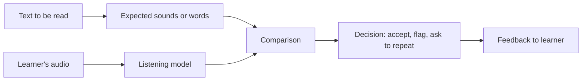

# Existing Solutions for Checking Arabic Reading and Recitation — How They Are Built

**Project:** Muallim (Telegram reading trainer, textbook *al-Muallim ath-Thani*)
**Date:** 2026-11-17
**Status:** desk research. No app was installed and no system was run; everything below comes from papers, documentation, product pages and one independent review.
**Scope:** Arabic only — Quran recitation, Arabic for non-native learners, Arabic reading for children. Other languages follow in a separate report.
**Relation to earlier reports:** Phase 1 compared *models*, Phase 2 *datasets*. This report describes *whole solutions*: what a learner sees, what happens inside, and what each design needs.

---

## 1. Summary

1. **There are ten distinguishable ways to build such a system**, from a human teacher on a video call to a live voice model that talks back. Seven of them use speech technology (section 3).
2. **All automatic systems share the same five building blocks:** text → expected sounds; a model that listens; a comparison with what was expected; a decision about what to tell the learner; and the feedback itself. Products differ mainly in the middle three (section 4).
3. **The market leader checks words, not sounds.** Tarteel follows recitation and flags missed or wrong words; letter-level detection was named only as a future goal when the feature launched, and an independent review found it unable to detect vowel-sign errors.
4. **Products that claim sound-level tajwid feedback exist, but none publishes an independent evaluation.** The one independent review found (2025) rated all four AI apps it tested as unreliable.
5. **The oldest system is still the most instructive.** HAFSS (2006) already had three ideas modern apps lack: it listens only for *expected kinds of error*; it has a confidence score with four possible responses, including "say it again"; and it can restrict itself to vowel errors for beginners.
6. **Almost nothing targets Muallim's first stage.** Products start from words or verses. The systems that handle single letters are either research prototypes or children's apps whose own description says they give "recognized-word feedback".
7. **No system found works inside Telegram, and none documents consent for the voice it collects.**
8. **For Muallim:** its present design (sound-level model without a language model, compared with a reference) belongs to the strongest family. What it lacks compared with the best examples is a decision policy — when to stay silent, when to ask for a repeat — and a restricted list of errors per lesson.

### Evidence marks

| Mark | Meaning |
|---|---|
| **[P]** | Primary source read in this session: paper text, documentation, model card, the product's own page |
| **[R]** | From the project's earlier reading (`sources.md`, earlier phase reports) |
| **[V]** | Vendor's own claim about its product — not independently checked |
| **[C]** | A competitor's page describing another product — treat with caution |
| **[S]** | Other secondary source (search summary, news) |

---

## 2. Method

- Searched for products (app stores, comparison pages), research systems (papers), open-source projects (GitHub, Hugging Face) and reviews.
- Read in full: the HAFSS paper (2006), the QVoice paper (2023), and the relevant sections of a 32-page critical review of the field (Al-Kharusi et al., 2025).
- Product descriptions come from vendors and competitors. Where a claim could not be confirmed by an independent source, it is marked [V] or [C].

---

## 3. The ten ways it is done

| # | Approach | How it works | Examples | Finest unit judged |
|---|---|---|---|---|
| 1 | **Human teacher online** | Video call or a teacher listens to sent recordings | Tutoring platforms (Qutor and many others); noorani-qaida.com (student sends a recording of any letter to the teacher) | Anything a teacher hears |
| 2 | **Listen-and-repeat without checking** | App plays a reciter; learner records and compares by ear | Learn Quran Tajwid, Quran Majeed | None (self-assessment) |
| 3 | **Word recognition + comparison with the text** | An ASR model turns audio into words; the words are aligned with the expected text; differences are mistakes | Tarteel; Maqam "Hifz"; open-source trackers; the memorisation checker studied by the supervisor's group | Word |
| 4 | **Recognition restricted to expected errors** | For each position the system prepares the correct sound and a list of likely wrong ones, and the recogniser chooses among them | HAFSS (2006) | Sound unit (consonant + vowel) |
| 5 | **Free sound recognition + alignment + rule engine** | A model without a language model writes down the sounds; they are aligned with the expected sounds; a rule engine names the error | Muaalem; HisnLabs tajweed; Quran Lab zipformer; IqraEval systems; Harf-Speech; QVoice | Sound, attribute |
| 6 | **Verification scoring** | For each expected sound, compute how well the audio fits it versus alternatives; flag when the score is low | TajweedFormer reference method; `fastconformer-quran` (three signals, two must agree); Azure Pronunciation Assessment; Microsoft Reading Coach | Sound, with a score |
| 7 | **Classifier per rule or letter** | A small model answers one question: which letter is this, or was this rule applied | QDAT rule classifiers; makhraj classifiers; ArPA; Indonesian letter classifiers; Horouf | Clip |
| 8 | **Acoustic comparison with a reference reciter** | Learner's audio is aligned in time with a master recording and differences in melody, pace, pauses are shown | Maqam "Imitate" (12 reciters); syllable matching by time-warping (El-Kasasy, cited in HAFSS); apparently TajweedMate | Whole take or syllable |
| 9 | **Live voice model as teacher** | A general audio language model listens and speaks corrections in conversation | QuranCast (built on Gemini) | Whatever the model says |
| 10 | **Not audio** | Camera watches lip movement | One research paper | Vowel shape only |

Sources: [P] HAFSS and QVoice papers, model cards and repositories from Phase 1; [P] Al-Kharusi et al. 2025 for the classification of platforms into tutoring, shadowing and AI analysis; [V]/[C] product pages for 3, 8, 9.

---

## 4. Building blocks: what every automatic system needs

| Block | What it does | Options seen | Examples |
|---|---|---|---|
| **1. Text → expected sounds** | Turns vowelled Arabic text into the sequence the learner should produce, applying recitation rules | Rule engines over Quran text; a vowelizer for unvowelled text; ready tables for all 6,236 verses | `quran-transcript` (Muaalem), `quran-g2p` (Quran Lab), RDI transcription engine (HAFSS), Halabi phonetiser (IqraEval), Farasa vowelizer (QVoice) |
| **2. Listening model** | Converts audio into words, sounds, or scores | Classical statistical models (HAFSS); word ASR fine-tuned on Quran (Tarteel: NVIDIA toolkit, reported 4 % word error); self-supervised encoders with sound-level output (most 2025–2026 systems); spectrogram image classifiers (ArPA) | Phase 1, sections 3.1–3.8 |
| **3. Alignment** | Matches what was heard to what was expected | Edit-distance alignment of two strings; time alignment of audio to text; no alignment needed when scoring each expected unit directly | HisnLabs (edit distance), Quran Lab forced aligner, TajweedFormer (direct scoring) |
| **4. Duration measurement** | Judges lengths (prolongation), which symbols alone cannot show | Count frames and divide by the reader's own pace | HAFSS "recitation rate normalisation"; HisnLabs: length ÷ half the median natural prolongation in the phrase |
| **5. Decision policy** | Decides what to report | One threshold; several thresholds by error severity; agreement of several signals; "ask to repeat" zone | HAFSS (four responses); HisnLabs (0.3 for remarks, 0.7 for clear mistakes); `fastconformer-quran` (2 of 3 signals); TajweedFormer (four presets from strict to very sensitive) |
| **6. Feedback** | Tells the learner | Colour on the word or letter; name of the rule; mouth-position picture; correct audio by a reciter or synthetic voice; stars; spoken correction | Tarteel (word colours), QVoice (letter colours, stars, audio), Qari AI (rule + how to fix), Amal (mouth shape), QuranCast (speech) |
| **7. Data** | Trains and tests the model | Professional reciters; app users' recordings; experts imitating errors; synthetic errors by speech synthesis; real learner errors labelled by teachers | Tarteel: "more than 75,000 minutes" of curated recitation [V]; Phase 2 |
| **8. Delivery** | Where it runs | Live streaming on the phone; record-then-check on a server; record-then-check on the device | Tarteel and Quran Lab (live); QVoice (server, answer within 1.5 s); TajweedMate, Google Read Along (on device, offline) |

---

## 5. Products

### 5.1 Quran recitation apps

| Product | What it checks | Approach | Runs | Price | Known problems |
|---|---|---|---|---|---|
| **Tarteel** | Missed, wrong, extra, misplaced words while reciting from memory; voice search for a verse | 3. Word ASR + comparison. Fine-tuned on NVIDIA's speech toolkit; reported 4 % word error; launch after "over 3 years" of work [V][S] | Live; server-backed | Mistake detection in the paid tier, about $12.99 a month or $99 a year [C] | Letter-level detection named only as a future goal at launch. Independent review: cannot detect vowel-sign errors, misclassifies correct prolongation as error, "optimised for generic Arabic speech recognition". User reviews report correct recitation flagged when reciting fast |
| **Qari AI** | Claims rule-level detection (prolongation, ikhfa, idgham, qalqalah and more), names letter and rule and how to fix | Not disclosed; described as "phoneme-level" [V] | Android; beta | Free in beta | Precise articulation-point assessment labelled "experimental" by the vendor; no independent evaluation |
| **QuranCast** | Spoken corrections of articulation, nasalisation, qalqalah, prolongation; 29-stage reading curriculum | 9. Live voice model (Gemini) [V] | Web, Android, iOS; needs internet | Minute packages $9.99–49.99; 10 free minutes | No published accuracy; a general model's Arabic sound perception was weak in Phase 1 (15–17 % error) |
| **TajweedMate** | Record, then compare with a reference | 8, on device, offline [C] | iOS, Android | Free | Independent review: "very low accuracy", appears overfitted to its reference reciter's voice, rewards imitation |
| **Qara'a** | Gamified lessons; paid automatic error detection | Reviewers suspect a fixed rule table with little acoustic modelling | App | Paid feature | Independent review: frequent false positives and negatives |
| **Al Siraat** | Separate pronunciation module and verse recitation | Server processing | Early access | — | Independent review: non-functional; privacy concerns from mandatory server processing |
| **Maqam AI** | "Imitate": compares one verse with a chosen master reciter on melody, pace, pauses, endings; "Hifz": live word checking | 8 + 3 [V] | App; matching needs internet | — | Vendor states it does not grade tajwid or teach rules |
| **Recite Quran** (iPhone) | Tajwid and prolongation timing "to the millisecond" | Not disclosed; offline [V] | iPhone | — | No evidence found |
| **Thurayya** (Alphazed) | Children 4–12 recite; app corrects "every ayah"; has a Noorani Qaida section | Not disclosed [V] | Web, apps | Free start | Claims at verse level; nothing published on method |
| **Quranly** | Memorisation planner; tajwid feedback by human teachers | 1 | App | — | No automatic checking |
| **Learn Quran Tajwid** | Lessons, audio examples, quizzes | 2 | App | — | Does not listen to the learner |

Sources: Tarteel blog and NVIDIA customer story [V][S]; Al-Kharusi et al. 2025, section 3.6.3 and Table 6 [P]; QuranCast, Qari AI and Maqam comparison pages [V][C]. The independent review does not publish its test protocol, so its verdicts are expert opinion, not measurements.

### 5.2 Arabic reading and pronunciation outside the Quran

| Product | For whom | What it checks | Approach | Notes |
|---|---|---|---|---|
| **Google Read Along** (Arabic since 2020) | Children learning to read | Whether the child reads the words of a story; helps on a tapped word | 3/6 on the device; works offline; voice is not sent to servers and is discarded [V] | Vendor reports reading-fluency gains of 35–85 % after 100 minutes for weak readers; not independent. No detail on Arabic vowel signs |
| **Microsoft Reading Coach / Reading Progress** | School pupils | Mispronounced words; five words to practise; teacher can adjust sensitivity | 6: built on Azure Pronunciation Assessment [P] | Available in 81 languages; which get full pronunciation feedback is not stated. For Arabic, Azure returned scores without sound labels (Phase 1) |
| **Amal** (Alphazed) | Children 3–15 | Read-aloud practice; "each missed sound gets a mouth-shape fix" | Vendor's own wording: compares recognised full text with expected text; "recognized-word feedback, within documented limits" [V] | So the listening is word-level; sound-level feedback is derived from which word failed. Vowel signs not mentioned. No privacy statement about voice on the page |
| **QVoice** (Qatar Computing Research Institute, 2023) | Non-native adults; natives reducing dialect influence | Score per letter (colour) and per utterance (stars); insertions, deletions, substitutions | 5: end-to-end mispronunciation model with an attention part for dialect influence; server; answer in under 1.5 s [P] | 400+ words and phrases, each with transliteration, translation, picture, reference audio by synthetic voice. Research demo |
| **Mondly, Rosetta Stone and similar** | Adult language learners | "Real-time pronunciation feedback" | Not disclosed [S] | General language apps; no Arabic-specific method found |

### 5.3 What users pay for

- Subscription for automatic checking: about $100 a year (Tarteel). [C]
- Pay-per-minute for a live voice model: $10–50 packages (QuranCast). [V]
- Free apps exist where checking runs on the phone (TajweedMate, Google Read Along). [C][V]
- Human tutoring remains the main paid service in this field; the review lists more than a dozen platforms. [P]

---

## 6. Research and open systems in detail

### 6.1 HAFSS (RDI and Cairo University, 2006) — commercial product for non-native learners

| Part | How it works |
|---|---|
| Unit of analysis | Not the phoneme but the unit of traditional teaching: consonant + short vowel, consonant + long vowel, bare consonant, and their doubled forms. Chosen because "most Qur'an learners are not familiar with phonemes" |
| Expected text | A transcription engine reads the Quran text and produces the correct sound sequence with recitation rules and their exceptions |
| Error hypotheses | A database of **663 rules** of typical recitation errors. Each rule says: if the current unit, the previous and the next look like this, add this wrong variant. The result is a lattice of the correct reading plus probable wrong ones |
| Recognition | The recogniser may only choose among the paths in the lattice. It does not transcribe freely |
| Restriction per lesson | A subset of rules can be switched on — the paper's example: "vowel type" errors only, "for a realization dedicated to beginners" |
| Speaker adaptation | The acoustic model adapts to each user's voice |
| Durations | A separate layer checks lengths, with normalisation for the reader's speed |
| Confidence | A likelihood ratio between the chosen path and the next best |
| **Four possible responses** | 1) say nothing — "good for novice users because reporting false alarms discourages them"; 2) ask to repeat; 3) report an unidentified error and ask to repeat; 4) report the most probable error |
| Feedback | Each error rule is linked to a colour code, a text message, an audio message and the relevant recitation rule |
| Reported result | On 507 utterances labelled by experts, 6.6 % of segments were wrong. Of those errors the system identified 62.4 %, asked for a repeat on 22.4 % and wrongly accepted 14.9 %. On correct speech it asked for a repeat in 5.1 % of utterances |

Source: Abdou et al., Interspeech 2006 [P]. The 2025 review notes the system was not widely adopted in twenty years and questions its test population. [P]

### 6.2 Modern sound-level pipelines

| System | Expected sounds | Listening | Comparison and decision | Output to the app |
|---|---|---|---|---|
| **Muaalem** (current bot model) | `quran-transcript` phonetic script with rule levels | 0.6B model, several outputs: sounds + ten articulation attributes | Compare sequences; the app decides | Sounds and attributes with probabilities [R] |
| **HisnLabs tajweed** | Same phonetiser; the app supplies the verse text; a word ASR can find which verse was read | 20.6M model distilled from Muaalem; 50 frames per second; probability and time for every symbol | Edit-distance alignment; rule engine; two probability thresholds (0.3 remarks, 0.7 clear mistakes); lengths from frame counts ÷ reader's pace | Per word: ok flag, prolongation findings, notes in Arabic, English or French; a demo app shows each word as correct / to review / mistake / forgotten / self-corrected [P] |
| **Quran Lab TajweedFormer** | `quran-g2p`: 38 sound classes with rule provenance | 65M streaming model with separate outputs for identity, timing, doubling, attributes, boundaries | No verdict built in. Reference method: score single-unit alternatives against the expected verse, combine two outputs per error class, flag above per-class thresholds; four presets | Raw signals per chunk; the app builds feedback [P] |
| **`fastconformer-quran`** | Vowelled text tokens | 115M text model with frame scores | Three signals — a small trained "pronunciation head", distance to master reciters, likelihood score — flag when two agree | Per-letter feedback over 27 rules [P] |
| **Harf-Speech** | Arabic phonetiser | Fine-tuned 1B model | Edit-distance alignment; blended score; a language model segments words | Score aligned with speech therapists' ratings (correlation 0.79) [P] |
| **IqraEval systems** | 68-symbol Arabic set | Self-supervised encoders + CTC | Sequence comparison only | Sound sequence [P] |
| **QVoice** | Vowelizer + word database | End-to-end model scoring each letter | Model outputs scores directly | Letter colours, stars, cues [P] |

### 6.3 Checking memorisation from transcripts

The supervisor's group studied a production checker that works on ASR transcripts of memorisation recordings (pattern 3). Findings relevant to design: [P] abstract, arXiv:2609.12085

- A plain word-by-word difference with the reference already locates most events (localisation F1 0.83) but labels them poorly (0.53).
- The hard part is not detection but conventions: repetitions, self-repairs, opening formulas and accepted spelling variants must not count as mistakes. Ten labels were needed.
- A missing text-normalisation step was enough to push one automatic solution below the naive baseline.

### 6.4 Classifier systems

| System | Task | Result reported | Criticism in the 2025 review |
|---|---|---|---|
| QDAT classifiers (LSTM, EfficientNet) | Three rules on one verse | 96–98 % | Whole-verse yes/no cannot say *where* the error is; one verse only |
| Makhraj classifiers | Which articulation region for an isolated letter | — | "Identifies only the most probable region" without diagnostic feedback; ignores the vowel sign |
| ArPA (children) | Mispronounced letter from a spectrogram image | 99 % on its own data | Research prototype [S] |
| Horouf | 112 vowelled letters | ≈65 % | Phase 1 |

---

## 7. Comparison of the approaches

| Criterion | 3. Word ASR + diff | 4. Restricted to expected errors | 5. Free sounds + rules | 6. Verification score | 7. Classifier | 8. Reference comparison | 9. Voice model |
|---|---|---|---|---|---|---|---|
| Finest unit | Word | Sound unit | Sound, attribute | Sound, with score | Clip | Take | Unclear |
| Vowel-sign errors | No (unless text model outputs them) | Yes | Yes | Yes | Only if trained for it | No | Unclear |
| Says *which* error | Which word | Yes, from the rule | Yes | Partly (score per alternative) | Only its one question | No ("differs here") | In words, unverifiable |
| Unexpected errors | Missed | **Missed** — only listed errors exist | Seen in principle | Seen as low score | Missed | Seen as difference | Unclear |
| False alarms on correct reading | Low for words | Controlled by confidence | Depends on model; 4–9 % of words (HisnLabs) | Tunable; 0.2–0.8 % at strict settings (Quran Lab) | Unknown | High if voices differ | Unknown |
| Needs learner-error data | No | No (needs expert rules) | Helps greatly | For thresholds | Yes | No | No |
| Needs expert knowledge | Little | **A lot** (663 rules) | Phonetiser + rule engine | Phonetiser | Little | None | None |
| Works on one letter | Poorly | By design | Weak point (Phase 1) | Unknown | By design | Possible | Unknown |
| Cost to run | Medium | Low | Medium | Medium | Low | Low | High, per minute |
| Evidence | Mature for words | One 2006 evaluation | Benchmarks (F1 0.72) | Only learner numbers in the field (32–46 % caught) | Small own test sets | None | None |

---

## 8. What I noticed

1. **The field moved from "listen only for expected errors" to "write down everything and compare" — and lost the decision policy on the way.** HAFSS decided what to say using confidence and the learner's level. Most modern open models stop at the sound sequence and leave the decision to the app. Quran Lab says so explicitly: "The SDK is an inference engine."
2. **Vendors' claims and the one independent review point in opposite directions.** Marketing describes real-time sound-level correction; the review found the tested apps unreliable, and noted that the market leader recognises words rather than judging sounds. Neither side publishes test data.
3. **"Sound-level feedback" in children's apps is often derived from word recognition.** Amal's own page says so. A wrong word tells the app which sound to show a tip for; it does not mean the sound was heard as wrong.
4. **Three products compare the learner with a master reciter's voice.** The review's criticism of this is specific: it rewards imitation of a voice and treats natural variation as error.
5. **Everyone needs the text-to-sounds engine, and for the Quran several good ones are open.** For non-Quran vowelled text (a primer's syllables and words) the tools are fewer; the bot already has its own solution.
6. **Speed normalisation appears twice, twenty years apart** (HAFSS, HisnLabs). Any judgement of length needs the reader's own pace, which matters even more for slow beginners.
7. **Self-correction and repetition are a first-class problem** in the memorisation checker and in the HisnLabs demo ("self-corrected" as a word state). The project already treats self-correction separately.
8. **Running on the phone is used as a privacy argument** (Google, TajweedMate, Quran Lab). A Telegram bot cannot do this; it must rely on consent instead (Phase 5).
9. **Beginners are named as a user group but not served by design.** Only HAFSS mentions restricting errors for beginners, and only as a possibility.
10. **The 2025 review argues for building on rules and articulation knowledge rather than on data alone.** Its target is the same weakness Phase 1 called "hears the rule, not the learner", seen from the other side: data-driven models inherit the bias of their data.

---

## 9. What this means for Muallim

### Where Muallim stands

Muallim is in family 5: a sound-level model without a language model, comparison with a reference, rules that name the error and an explanation in Russian. This is the family with the best benchmark evidence. In two respects it is ahead of the products reviewed: it stores the full trace of each decision, and it has teacher labelling built in.

### Ideas worth adopting, with their source

| Idea | Source | Fit for Muallim |
|---|---|---|
| Four responses by confidence: stay silent, ask to repeat, "something is off, try again", name the error | HAFSS | High. The bot now always names errors. For beginners, silence on doubtful cases protects motivation. Changes methodology — author decides |
| Error list restricted per lesson (vowel errors only at first) | HAFSS | High. Stage I teaches letters with three vowels; the bot could judge only the lesson's target and the vowel. Already an open question in the project (OQ-12) |
| Likely-error lists for our learners (which sound a Russian speaker substitutes for which) | HAFSS rule database; Phase 1 verification scoring | High. A small table of expected substitutions per letter would let the verifier test "target versus its usual substitute" instead of everything |
| Units of traditional teaching, not phonemes, in feedback | HAFSS | Already done: the bot shows syllable cells |
| Two thresholds: lenient for remarks, strict for clear mistakes | HisnLabs | Medium. Matches the project's distinction between clear and hidden errors |
| Length judged relative to the reader's own pace | HAFSS, HisnLabs | Medium now (Stage I has little prolongation), high later |
| Several independent signals, flag when two agree | `fastconformer-quran` | High; it is the "verifier" proposed in Phase 5 |
| Presets from strict to sensitive | Quran Lab | Medium: a teacher could choose strictness per learner, as Microsoft allows teachers to do |
| Word states including "self-corrected" | HisnLabs demo, memorisation study | Already present |
| Reference audio and learning cues beside the verdict | QVoice | Present (reference recordings, book page) |
| Comparison with a reference recording | Maqam, TajweedMate | Only as one signal among several, and against several voices — the review's criticism of single-reciter comparison is convincing |

### What not to copy

- Word recognition as the judge of pronunciation (Tarteel, Amal): it cannot see vowel errors.
- A single master reciter as the yardstick.
- A general voice model as the teacher: no evidence, per-minute cost, and the learner cannot verify what it says.
- Claims of accuracy without a published test: the review shows how this is read by experts.

### Gaps Muallim could fill

- A documented, evaluated system for the **letters-and-vowels stage** for adult non-Arab beginners.
- A published **decision policy** (when the system stays silent) with measured false-alarm rates.
- Delivery through a **messenger**, with documented consent.
- An evaluation against teachers that others can reproduce — the thing every vendor lacks.

---

## 10. Limitations

- No product was installed or tested; behaviour is described from texts.
- Vendor pages are marketing. Competitor pages are biased against the products they describe.
- The independent review (Al-Kharusi et al., 2025) is a preprint, gives no test protocol for its app verdicts, and argues for its own preferred approach.
- Tarteel's internal design is known only from its launch announcement and a hardware vendor's customer story.
- Arabic-language sources (app stores, forums, Arabic papers) were not searched in Arabic.
- Apps for adult learners of Arabic as a foreign language (Mondly, Rosetta Stone and others) disclosed nothing about their method.

---

## 11. Open questions

1. How do Qari AI and Thurayya actually judge sounds? Only a hands-on test or a reply from the vendors can tell.
2. Does Google Read Along handle vowelled Arabic for beginners, and how does it react to a wrong vowel?
3. Is the HAFSS error-rule database or any similar list of typical learner errors available?
4. Which substitutions do Russian- and Kazakh-speaking beginners actually make? Sources in the project list candidates; only our own labelled data will confirm.
5. Would a "stay silent when unsure" policy be acceptable to the tajwid teacher, given that the Quran should be read without error? (Related to the project's OQ-14.)

---

## 12. Next: other languages

Planned for the following report, as the author requested:

| Area | Why it is relevant |
|---|---|
| Reading tutors for children (Project LISTEN, Amira, SoapBox, Dutch and French school systems) | Closest task: a beginner reads known text aloud; decades of evaluation |
| Pronunciation training for English learners (ELSA, Duolingo, Speechace, research benchmarks) | Largest market and literature; the decision-policy and feedback research is there |
| Mandarin tone and pinyin trainers | A language where a small mark changes the sound, like vowel signs |
| Other Quran-adjacent or script-learning cases (Hebrew, Hindi, Japanese kana) | Learning to read a new script from zero |

---

## Sources

**Read in full or in the relevant part**
- Abdou S. M. et al. Computer Aided Pronunciation Learning System Using Speech Recognition Techniques (HAFSS). Interspeech 2006 — https://www.cs.toronto.edu/~asamir/papers/is06.pdf
- El Kheir Y. et al. QVoice: Arabic Speech Pronunciation Learning Application. Interspeech 2023; arXiv:2305.07445 (SRC-150)
- Al-Kharusi M. H., Hayat K., Al Ruqeishi K. B., Lone H. R. A Critical Review of the Need for Knowledge-Centric Evaluation of Quranic Recitation. Preprint, 10 November 2025; arXiv:2510.12858 — https://arxiv.org/abs/2510.12858
- HisnLabs tajweed repository — https://github.com/HisnLabs/tajweed ; model — https://huggingface.co/Hisnlabs/tajweed-v2
- Quran Lab TajweedFormer V4 — https://huggingface.co/Quran-Lab/tajweedformer-v4
- `fastconformer-quran` — https://huggingface.co/Muno459/fastconformer-quran
- What Counts as a Mistake? Annotating Recitation Events in Quran Memorization Transcripts. arXiv:2609.12085 (SRC-068) — abstract
- A Comparative Study of Pretrained Transformer Models for Quranic ASR. arXiv:2606.19747 — abstract
- Earlier reports in this folder: `PHASE_1_ASR_RESEARCH.md`, `PHASE_2_DATASET_RESEARCH.md`, `PHASE_5_ARCHITECTURE_AND_CONSENT.md`

**Vendors' own pages**
- Tarteel: Introducing Mistake Detection — https://tarteel.ai/blog/introducing-mistake-detection/ (SRC-046)
- NVIDIA customer story on Tarteel — https://www.nvidia.com/en-us/case-studies/automating-real-time-arabic-speech-recognition/
- Alphazed Amal — https://www.thealphazed.com/amal ; Thurayya — https://www.thealphazed.com/thurayya
- Qari AI — https://qariai.app/best-ai-quran-app
- Maqam AI — https://maqamapp.com/blog/maqam-vs-tarteel-vs-learn-quran-tajwid
- QuranCast — https://www.qurancast.co/blogs/qurancast-vs-tarteel-qari-ai-tajweedmate-comparison
- Google, Read Along in Arabic — https://blog.google/intl/en-mena/product-updates/android-chrome-and-play/read-along-google/
- Microsoft, Reading Coach — https://techcommunity.microsoft.com/blog/microsoft365insiderblog/improve-learners’-literacy-skills-with-ai-powered-reading-coach/4355417

**Other**
- Integrating AI into Qur'an learning: Technical advances and pedagogical gaps. ScienceDirect, 2026 — https://www.sciencedirect.com/science/article/pii/S259029112600063X (not read)
- A Novel Speech Analysis and Correction Tool for Arabic-Speaking Children (ArPA). arXiv:2411.13592
- Abjad-Kids: An Arabic Speech Classification Dataset for Primary Education. arXiv:2603.20255
- Noorani Qaida teacher-feedback platform — https://noorani-qaida.com/
